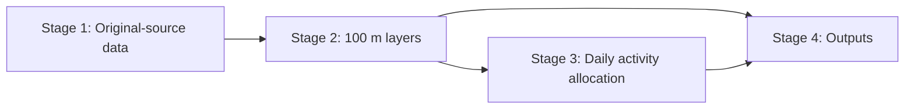

# Population modelling code

| Stage | Programs | Data read | Data written |
|---|---|---|---|
| [1. Data inputs](stage_1_data_inputs/) | City-source extraction and verification | External source files/indexes, or supplied raw subsets | `01_inputs/demo/raw/`, provenance manifests and verification status |
| [2. 100 m layers](stage_2_100m_layers/) | Source preparation and model-layer export | Original sources and supplied study settings | `04_intermediate/demo/stage_2/` |
| [3. Allocation of daily activities](stage_3_activity_allocation/) | Attractiveness, gravity allocation and network assignment | Stage 2 layers | `04_intermediate/demo/stage_3/` and packaged output components |
| [4. Outputs](stage_4_outputs/) | Hourly population, functional land use and checks | Stage 2 shares and Stage 3 results | `05_outputs/demo/` and `06_docs/figures/` |

Each stage link opens its code directory. The [method guides](../06_docs/README.md#methods) explain the data-processing and modelling procedures. Each stage folder contains its executable programs and calculation modules. Configuration is defined in Stage 1 and imported where needed. `03_run/runtime/run_parallel.py`, `work_queue.py` and `memory_guard.py` coordinate execution across stages. `03_run/run_city_demo.py` verifies the source subsets, executes all six Stage 2 preparation programs, computes Stage 3 allocations and writes Stage 4 outputs. Source extraction is a separate Stage 1 command. Stage 2 programs read local raw city subsets; Stage 3 reads the prepared routing graphs. Hourly location shares and calibrated settings are adopted study products. Their upstream survey and calibration records remain external.
