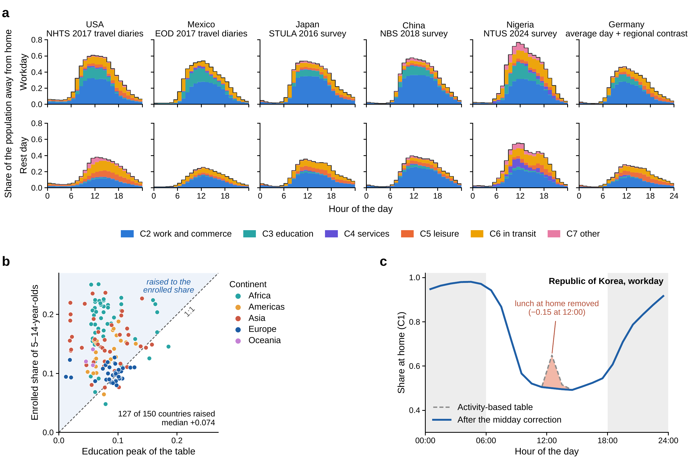

# Time use: derivation of hourly location shares

The hourly location-share tables are Stage 2 intermediate products. This guide describes their derivation, numerical settings and use in the population model. The supplied tables are stored in [demo/stage_2/hourly_location_shares/](demo/stage_2/hourly_location_shares/).

## Contents

- [1. What the 24-by-7 matrix represents](#1-what-the-24-by-7-matrix-represents)
- [2. Diary records to weighted hourly shares](#2-diary-records-to-weighted-hourly-shares)
- [3. Published activity tables and daily totals](#3-published-activity-tables-and-daily-totals)
- [4. Workdays, rest days and donor transfer](#4-workdays-rest-days-and-donor-transfer)
- [5. Reconstructing presence from travel diaries](#5-reconstructing-presence-from-travel-diaries)
- [6. Adjusting imputed lunch-hour locations](#6-adjusting-imputed-lunch-hour-locations)
- [7. Accounting for school-age children](#7-accounting-for-school-age-children)
- [8. Country-specific timing calibration](#8-country-specific-timing-calibration)
- [9. Derivation of the supplied city profiles](#9-derivation-of-the-supplied-city-profiles)
- [10. Files, checks and model use](#10-files-checks-and-model-use)
- [11. Numerical settings and their provenance](#11-numerical-settings-and-their-provenance)
- [12. Sources and reproducibility boundaries](#12-sources-and-reproducibility-boundaries)
  - [Country-specific sources for 22 countries](#121-country-specific-day-type-data-sources)
- [13. Time-use profiles and corrections](#13-time-use-profiles-and-corrections)

## 1. What the 24-by-7 matrix represents

Each country and day type has a matrix of 24 local clock hours and seven location classes. Its entry s<sub>c</sub>(h, t) is the estimated fraction of people present in class c during hour h on day type t. The seven columns describe locations; they do not represent the seven days of a week. Workdays and rest days are stored in separate files.

| Class | CSV column | Meaning |
| --- | --- | --- |
| C1 | residential | Residential places |
| C2 | commercial_industrial | Workplaces, commerce and industry |
| C3 | education | Education places |
| C4 | medical_public | Medical and public-service places |
| C5 | leisure | Leisure, cultural and sports places |
| C6 | transportation | People in transit |
| C7 | other | Other places |

```math
\sum_{c=1}^{7}s_c(h,t)=1,\qquad 0\leq s_c(h,t)\leq 1.
```

The values are fractions, so 0.10 means 10% of the represented population. Summing one column over the 24 hours gives the average hours per person spent in that class during a day. Summing the whole matrix gives 24 hours. A column is not expected to sum to one.

The matrices are national temporal profiles applied to the population of each modelled city. City-specific spatial layers determine where that population is allocated. The matrix alone contains neither individual trajectories nor a map of destinations.

### How to read this guide

Sections 2-8 explain the upstream processing rules preserved in the source implementation. Sections 9-10 identify the products supplied for Helsinki, Kitakyushu and Takasaki-Maebashi and explain their use in the model. Section 11 lists numerical settings and their provenance. Section 12 lists the country-specific sources for 22 countries, provider references and implementation locations.

The supplied model reads the completed shares. Reconstructing them from survey records also requires the source surveys, classification crosswalks and harmonised reference tables described below. The upstream source records and harmonisation scripts are external.

## 2. Diary records to weighted hourly shares

Where time-use microdata contain activity episodes and location codes, the processing retains the reported location whenever it can be classified. Activity and location are separate fields: doing paid work does not, by itself, prove that the person was at a workplace.

### 2.1 Classify the records

Source-specific crosswalks map the original activity codes to 87 fine activities. The array uses positions 1-87, with position 0 unused. Original location codes map to C1-C7, or to one of two unresolved statuses: a reported but insufficiently specific non-residential place (status 7), or a missing location (status 8). A source rule assigns an unspecified other place to leisure when the activity belongs to the leisure group.

### 2.2 Split time across clock hours

An episode contributes only the minutes that overlap each hour. Its contribution is multiplied by the survey weight assigned by the source adapter. The shared routine wraps hours modulo 24 for diaries that extend past midnight. Already tabulated slots can instead enter with their assigned hour and duration. Workday and rest-day records are aggregated separately.

```math
M(h,a,z)=\sum_e w_e\,\mathrm{overlap\_minutes}(e,h)\, \mathbf{1}(a_e=a,\ z_e=z).
```

Here a is the fine activity, z is the location status, and w is the survey weight. The hourly denominator is the total weighted minutes across all activities and statuses in that hour. It is not the number of episodes or trips. Every hour must contain a positive amount of represented time.

### 2.3 Allocate unresolved locations

Let K(h,a,c) denote minutes with a classified location. Let U8 and U7 denote the two unresolved statuses. The inherited reference GF(h,a,c) gives the distribution of locations for an activity at that hour. GF_nonres is obtained by setting C1 to zero and renormalising the remaining six classes; when no non-residential reference mass remains, all of it is assigned to C7.

```math
\begin{aligned} J(h,a,c)&=K(h,a,c)+U_8(h,a)GF(h,a,c)+U_7(h,a)GF_{\mathrm{nonres}}(h,a,c),\\ L(h,c)&=\frac{\sum_a J(h,a,c)}{\mathrm{total\_weighted\_minutes}(h)}. \end{aligned}
```

This preserves classified minutes and imputes only the unresolved part. The source routines can also retain the unresolved fractions as diagnostics. These fractions describe how much information was imputed; they are not uncertainty intervals.

**Processing provenance.** tu_common.py: alloc_hours, accumulate, curves and V10.__init__. The GF table is read from the inherited harmonisation package, rather than estimated anew by these functions. Its original construction and input survey coverage require that package; the final 24 × 7 CSVs cannot recover them.

## 3. Published activity tables and daily totals

### 3.1 Published hourly or subhourly tables

Some sources provide activity participation rates without usable location observations. Subhourly rates are averaged within each clock hour, and original categories are combined into activity groups. The resulting hourly group shares A(h,g) are normalised to one.

A published group usually covers several fine activities. The code splits its share using the pooled reference minutes GM(h,a) for those activities at the same hour. If their total reference minutes are zero, it assigns equal proportions within the group.

```math
\begin{aligned} S(h,a)&=A(h,g)\frac{GM(h,a)}{\sum_{a'\in g}GM(h,a')},\\ L(h,c)&=\sum_a S(h,a)GF(h,a,c),\quad\text{followed by row normalisation}. \end{aligned}
```

The published table therefore supplies activity timing. The split into fine activities and the conversion from activities to locations depend on the inherited reference tables. The seven location shares are derived estimates even when the original activity participation rates were observed directly.

### 3.2 Daily totals with borrowed timing

Where only daily minutes by activity group are available, the code starts from another country’s hourly activity profile. It adjusts that profile to meet the target country’s daily-minute constraints through iterative proportional fitting. The target preparation also handles source-specific group definitions and constraints; the complete 24-hour budget must be feasible.

```math
\sum_g A(h,g)=1\quad\text{for each }h,\qquad 60\sum_h A(h,g)=\mathrm{target\_minutes}(g)\quad\text{for each }g.
```

Each iteration scales the group columns to their target totals, then normalises the hourly rows. Zero targets remove a group. A positive target with no support in the initial profile, an empty hour, or failure to converge causes an error. The stopping tolerance is a maximum daily-minute error below 10<sup>-7</sup>; it is checked every 10 iterations, with a limit of 12,000 iterations.

The adjusted group shares are split back into fine activities using the reference composition, then mapped to locations through GF. Where several timing references are specified, their reconstructed fine-activity profiles are averaged with equal weight. Source-specific average-day definitions are retained during this part of processing; they are not all interchangeable with a 5:2 weekly average.

**Processing provenance.** pathb_common.py: split_to_fine and table_curves; tu_common.py: curves_from_fine and fit; src_pathc_v11.py: targets_for, fine_by_daytype, _curves and make_build. GM is read as GLOBAL_MINUTES and GF as GLOBAL_FINE. The tolerances and equal-weight rules are study-defined computational choices.

## 4. Workdays, rest days and donor transfer

Day type is first identified from the source’s diary or table definition. For diaries with day-of-week and holiday fields, the shared rule classifies the specified weekend days and flagged public holidays as rest days. Without a holiday field, a weekday holiday cannot be identified by this rule. Some sources already provide weekday/weekend labels. The diary builder normally requires at least 100 diaries for a separate group, unless the adapter overrides this threshold; a non-empty pooled group is exempt.

### 4.1 Retain a national baseline; borrow the day-type contrast

For countries without adopted own day-type curves, the code takes an existing national average-day matrix B and multiplies it by donor ratios for each hour and location class. Donors are assigned by the study’s region table. A donor’s ratio is its day-type share divided by its average-day share; the ratio is set to one when the denominator is at most 10<sup>-6</sup>. Ratios are averaged equally across donors.

```math
\begin{aligned} r_t(h,c)&=\mathrm{mean}_{d\in\mathrm{donors}} \mathrm{ratio}\!\left[L_{d,t}(h,c),L_{d,\mathrm{all}}(h,c)\right],\\ L_{X,t}(h,c)&=\frac{B_X(h,c)r_t(h,c)}{\sum_k B_X(h,k)r_t(h,k)}. \end{aligned}
```

| Region | Assigned donors (ISO3) |
| --- | --- |
| North America | USA, CAN |
| Latin America | MEX, COL, PER, PRY |
| Western Europe | GBR, ESP, BEL |
| Eastern Europe and Central Asia | RUS, ALB |
| East Asia | JPN, KOR, CHN |
| South Asia | IND, PAK |
| Southeast Asia | CHN, IND |
| Middle East and North Africa | MAR |
| Sub-Saharan Africa | GHA, NGA, ZAF |
| Oceania | AUS |

If the national baseline is absent from the inherited index, the routine uses the mean of the donors’ average-day matrices. Saturday and Sunday are transferred only when every donor has the required curve. The same ratio method is also used by selected source adapters to preserve a national baseline while applying contrasts obtained from that country’s own day-type records.

Independent multiplication and normalisation do not guarantee that the final rest-day curve equals the mean of the Saturday and Sunday curves, or that a 5:2 combination exactly recovers the original baseline. The later school adjustment explicitly rebuilds the average-day matrix where it changes the workday curve.

**Processing provenance.** make_transfer.py: REGIONS and main; build_daytype.py: diary_source and ratio_on_city; tu_common.py: classify_days, day_ratios and apply_ratios. Regional membership, donor selection and equal donor weights are study-defined.

## 5. Reconstructing presence from travel diaries

The final upstream workflow replaces the initial USA, Mexico and Brazil time-use curves with curves reconstructed from household travel diaries. Each person is assigned a location class in 144 ten-minute intervals. Person expansion weights determine how much that person contributes to the population share.

### 5.1 Follow each person through the day

The starting class is the origin of the first trip when supplied, otherwise residential. A person without trips remains at home in this reconstruction. Departure is rounded down to the ten-minute boundary and arrival up. Intervals between departure and arrival are C6. After arrival, the person stays in the destination class until a later trip overwrites that assignment. A trip recorded as arriving before it departs is treated as crossing midnight and truncated at the end of the day.

```math
\begin{aligned} q(c,k)&=\frac{\sum_i w_i\,\mathbf{1}(\mathrm{location}_{i,k}=c)}{\sum_i w_i},\\ s(c,h)&=\frac{1}{6}\sum_{k\in h}q(c,k). \end{aligned}
```

Purpose and place crosswalks assign trip destinations to the seven classes. Residential visits can be C1 even when the destination is another household’s home. These shares describe presence, including people who did not travel. Counting trips, or using trip expansion weights as the population denominator, would estimate a different quantity.

| Selected source | Coverage represented in the implementation |
| --- | --- |
| USA: NHTS 2017 [R2] | Persons aged 5+ with a travel day; person weight WTPERFIN. Separate weekday, rest-day, Saturday and Sunday profiles. |
| Mexico: EOD 2017 [R3] | Valley of Mexico metropolitan survey. Travel records cover ages 6+, but the implemented person denominator includes household members of all ages; children without trip records remain at home. |
| Brazil: OD 2017 [R4] | São Paulo metropolitan survey; weekday presence reconstructed with person expansion weight FE_PESS. The geographic source is metropolitan, although its curve is used for the country. |

### 5.2 Fill the missing day types

Mexico has no Sunday travel curve in the selected input: Sunday is estimated from its Saturday curve multiplied by the USA Sunday/Saturday ratio. Mexico’s rest day is then the mean of Saturday and estimated Sunday. Brazil’s rest day is its weekday curve multiplied by the Mexico rest-day/weekday ratio; the analogous ratios supply Saturday and Sunday.

```math
\text{Transferred curve}=\mathrm{row\_normalise} \left[\mathrm{base}\times\frac{\mathrm{donor\_numerator}+0.002} {\mathrm{donor\_denominator}+0.002}\right].
```

The additive 0.002 is a study-defined stabiliser specific to this travel-diary transfer. It differs from the threshold-and-neutral-ratio rule in Section 4. Average days use (5 workdays + Saturday + Sunday)/7 for USA and Mexico, and (5 workdays + 2 rest days)/7 for Brazil. This is a representative weekly convention; it does not count public holidays.

**Processing provenance.** travel_diary.py: presence, usa, mex and bra; build_daytype_v2.py: ratio_apply and main.

## 6. Adjusting imputed lunch-hour locations

Converting activities to locations can assign meal time to residential places even when a person remains away from home. The implementation applies a lunch-hour adjustment to countries whose locations are inferred from activity tables or inherited national matrices. It is an explicit modelling rule; the affected cells do not become direct location observations after adjustment.

### 6.1 Which curves are adjusted

The initial curves for USA, Canada, the United Kingdom, Spain, Albania, South Africa, Ghana, Nigeria, Pakistan and India are exempt because their adopted diary processing uses location variables. All other indexed countries are eligible, including Finland and Japan. The procedure is applied separately to every available day type. The later USA, Mexico and Brazil travel-diary replacements bypass this correction.

### 6.2 Calculate the adjustment

At hours 12 and 13, a straight line between the vectors at hours 11 and 14 supplies a reference B. Only a residential share above that line is reduced. The removed share goes to non-residential classes according to their positive shortfalls below the same line. If there is no appreciable shortfall, their existing shares supply the redistribution weights.

```math
\begin{aligned} t&=(h-11)/3,\qquad h\in\{12,13\},\\ B(h,c)&=(1-t)L(11,c)+tL(14,c),\\ e&=\max[L(h,\mathrm{C1})-B(h,\mathrm{C1}),0],\\ d(c)&=\max[B(h,c)-L(h,c),0],\qquad c\ne\mathrm{C1},\\ L'(h,\mathrm{C1})&=L(h,\mathrm{C1})-e,\\ L'(h,c)&=L(h,c)+e\frac{d(c)}{\sum_{k\ne\mathrm{C1}}d(k)}. \end{aligned}
```

The code leaves the hour unchanged when the residential excess is at most 10<sup>-6</sup>. It uses the shortfall weights only when their sum exceeds 10<sup>-9</sup>; otherwise the last equation uses the normalised existing non-residential shares. The fallback assumes some non-residential mass is present.

### 6.3 What this changes

Every adjusted hour still sums to one. The daily totals of the affected classes generally change, because residential time is transferred to other classes. Hours outside 12 and 13 retain their previous values. This operation should therefore be distinguished from the later timing calibration, which preserves daily totals for each corrected class.

The adjustment is nonlinear: its positive-part and fallback operations depend on each curve. Adjusting Saturday, Sunday and an already combined rest day separately can yield a rest-day matrix different from the mean of the final Saturday and Sunday matrices. Replacing the supplied rest-day file with that mean would change the implemented temporal input.

**Processing provenance.** lunch_correction.py: DIARY_LOCATION, HOURS, REF and correct. The affected hours, reference hours, redistribution rule and thresholds are study-defined settings. Provider documentation for the underlying survey does not establish these particular choices.

## 7. Accounting for school-age children

Many time-use surveys omit younger children, while the population model represents residents of all ages. The upstream code therefore checks whether the maximum workday share in education places is below an estimated enrolled population aged 5-14. It applies the following adjustment to countries other than the selected USA, Mexico and Brazil travel-diary sources.

### 7.1 Estimate the enrolled share

Population counts for males and females aged 5-9 and 10-14 are divided by total population. The code uses World Bank indicators for adjusted net primary enrolment and net secondary enrolment, with gross enrolment as a fallback. Enrolment percentages are capped at 100% and divided by 100. Each indicator uses its latest non-missing observation in the downloaded source, so the input years may differ [R5].

```math
E=s_{5\text{--}9}\,p_{\mathrm{primary}} +s_{10\text{--}14}\frac{p_{\mathrm{primary}}+p_{\mathrm{secondary}}}{2}.
```

When age shares are missing, school_floor uses the median record of countries in the assigned region, or the global median if that regional set is empty. A remaining missing enrolment proportion is replaced by its global median. The diagnostic routine in age_coverage.py has its own columnwise filling procedure; school_floor is the routine that modifies the final matrices.

### 7.2 Increase education shares using their existing timing

Let p be the current daily maximum of the workday C3 share. If E exceeds p and p is positive, the gap is distributed over the day in proportion to the existing education curve. The same amount is removed from C1 in each hour, with a lower residential bound of 0.05.

```math
\begin{aligned} p&=\max_h L(h,\mathrm{C3}),\qquad \mathrm{gap}=E-p,\\ d(h)&=\max\left\{0,\min\left[\mathrm{gap}\frac{L(h,\mathrm{C3})}{p},L(h,\mathrm{C1})-0.05\right]\right\},\\ L'(h,\mathrm{C3})&=L(h,\mathrm{C3})+d(h),\\ L'(h,\mathrm{C1})&=L(h,\mathrm{C1})-d(h). \end{aligned}
```

The other five classes are unchanged. If p is zero, the routine skips the adjustment because there is no education timing profile to scale. If the residential bound is reached, the resulting peak can remain below E. E is thus an adjustment target rather than an unconditional output constraint.

Rest day, Saturday and Sunday remain unchanged. When a workday curve is modified and a rest-day curve exists, the average-day curve is regenerated as (5 × workday + 2 × rest day)/7.

### 7.3 Source values and study assumptions

The age counts and enrolment percentages are external data. Averaging the two enrolment rates for ages 10-14, comparing that estimate with the hourly education peak, reusing the existing timing shape, and retaining at least 5% residential presence are study-defined assumptions. This correction does not create complete activity diaries for children, and C3 may also contain adults attending education places.

**Processing provenance.** age_coverage.py: wb and table; build_daytype_v2.py: school_floor. Indicator codes: SP.POP.TOTL; SP.POP.0509.MA/FE; SP.POP.1014.MA/FE; SE.PRM.TENR with SE.PRM.ENRR fallback; SE.SEC.NENR with SE.SEC.ENRR fallback.

## 8. Country-specific timing calibration

After survey harmonisation and the preceding corrections, the upstream workflow tests small timing changes against hourly population observations for calibration cities in the USA, South Korea and Spain. This calibration is not applied to the supplied Finland and Japan matrices.

### 8.1 Shift and reweight the out-of-home curves

The affected classes are C2, C4, C5, C6 and C7. C3 is held fixed. A cyclic shift moves each affected curve later by delta hours; a fractional shift linearly combines the two neighbouring integer shifts. The shifted curve is then multiplied by an afternoon weighting function and rescaled to retain its original daily sum.

```math
\begin{aligned} g(h)&=\exp\!\left\{\beta\sin\!\left[2\pi(h+0.5-12)/24\right]\right\},\\ L'(h,c)&=L_{\mathrm{shifted}}(h,c)g(h) \frac{\mathrm{daily\_sum}(c)}{\sum_j L_{\mathrm{shifted}}(j,c)g(j)},\\ L'(h,\mathrm{C1})&=1-\sum_{c\in\{\mathrm{C2},\ldots,\mathrm{C7}\}}L'(h,c). \end{aligned}
```

The operation preserves daily person-hours in each corrected class, and therefore also in the residential complement. A valid matrix still requires a non-negative residential complement; the correction function itself does not clip a negative value.

### 8.2 Select parameters using calibration cases

The search considers delta = 0, 0.25 or 0.5 hours and beta = 0 or 0.1. It maximises the mean Tier D case score after clipping individual case scores to [-1, 2]. Ties favour the smallest delta + beta. The selected correction is adopted only when its gain over the uncorrected mean score is at least 0.25. These are study-defined search settings and an adoption rule; the chosen pair is a calibration result.

| Country / fitted day type | Adopted delta (h) | Adopted beta | Application |
| --- | --- | --- | --- |
| USA / workday | 0 | 0 | No correction adopted |
| USA / rest day | 0.5 | 0.1 | Rest day, Saturday, Sunday |
| South Korea / workday | 0.5 | 0.1 | Workday |
| South Korea / rest day | 0 | 0 | No correction adopted |
| Spain / workday | 0.5 | 0.1 | Workday |

These entries are recorded in the original timing_calibration.json. They are fitted results from calibration cases, not independent evidence that the temporal profiles are accurate in other cities. Repeating the fit requires the relevant observations and their calibration/evaluation split.

### 8.3 Preserve the order of operations

The processing order is initial survey curves, regional day-type transfer, lunch adjustment, travel-diary replacement, school adjustment, then timing calibration. Donor ratios used earlier are not automatically recomputed when a donor curve is subsequently replaced or calibrated. For example, Finland’s earlier Spain-based transfer does not acquire Spain’s later timing shift.

**Processing provenance.** timing_correction.py: shift, tilt and correct; calibrate/timing_calibration.py: score_cases, main and write_tables; 07_validation/calibration/timing/timing_calibration.json in the source package.

## 9. Derivation of the supplied city profiles

### 9.1 Helsinki: Finland (FIN)

Helsinki uses the inherited Finland national average-day matrix. Its workday, rest-day, Saturday and Sunday contrasts are transferred from the United Kingdom, Spain and Belgium, with equal donor weights. Each transferred hourly row is normalised. The lunch adjustment is then applied separately to the available day-type curves.

The school adjustment increases the workday education share using the existing Finnish education timing. The source index rounds its target to E = 0.100 and the preceding peak to 0.083. The supplied final workday education peak is 0.09987660984. The average-day file is rebuilt from the corrected workday and supplied rest day with weights 5/7 and 2/7. No timing calibration from Section 8 is applied.

The supplied index identifies Finland’s baseline as a V11 national matrix. Its survey vintage, sample selection and fine-activity crosswalk require the upstream baseline package; these metadata are not stored in the supplied CSVs. The three donor countries determine the transferred day-type contrasts, not the origin of the Finnish baseline.

### 9.2 Kitakyushu and Takasaki-Maebashi: Japan (JPN)

Both Japanese cities use the same national day-type matrices. The upstream adapter selects the 2016 Survey on Time Use and Leisure Activities, Questionnaire A, both sexes, age group 15+. The official survey covers persons aged 10+; 15+ is the subset selected by the code [R1].

For each published activity category, the adapter averages four 15-minute participation rates within a clock hour, then combines categories into nine groups: sleep, personal care, work, travel, study, household activities, leisure, media and other. These groups are expanded to fine activities with GM and converted to seven location classes with GF, as in Section 3. Thus the day-type activity timing comes from Japanese statistics, while location allocation uses the harmonised reference.

Weekday, Saturday and Sunday tables are processed separately. The initial rest-day activity table averages the normalised Saturday and Sunday profiles; the initial average day uses weights 5:1:1. The lunch adjustment is subsequently applied to each resulting location curve. Finally, the school adjustment changes the workday and rebuilds the average day using the corrected workday and existing rest day.

The source index rounds Japan’s school target to E = 0.081 and the preceding peak to 0.056. The supplied final education peak is 0.08054116923. The displayed index targets are rounded descriptions, not exact calculation inputs. No timing calibration is applied to Japan.

### 9.3 Why the final rest day is a separate product

The supplied rest-day matrix differs from the mean of the final Saturday and Sunday matrices by up to 0.00081244 for Finland and 0.00714354 for Japan, or approximately 0.081 and 0.714 percentage points. Independent transfer/normalisation and the nonlinear lunch adjustment can prevent equality. The model uses the supplied rest-day file; it does not reconstruct that file from the two weekend-day files.

**Processing provenance.** location_share_sources.csv in the supplied hourly_location_shares directory; src_jpn_stula.py: YEAR, AGE, tables and build; make_transfer.py; lunch_correction.py; build_daytype_v2.py: school_floor. Peak values and differences above are calculated from the supplied CSVs.

## 10. Files, checks and model use

The numerical products are in [demo/stage_2/hourly_location_shares/](demo/stage_2/hourly_location_shares/). The source index has one row per country and day type, with fields iso3, daytype, file, method, donors and region. It links Finland and Japan to ten CSVs in total.

| Day-type key | Filename suffix | Interpretation |
| --- | --- | --- |
| workday | _workday_location_shares.csv | Adopted workday curve |
| restday | _rest_day_location_shares.csv | Adopted rest-day curve |
| saturday | _saturday_location_shares.csv | Saturday curve |
| sunday | _sunday_location_shares.csv | Sunday curve |
| alldays | _all_days_location_shares.csv | Supplied average-day curve |

Each filename begins with FIN or JPN. Each CSV has an hour column containing the integers 0-23, followed by the seven columns in Section 1. Row h describes local time from h:00 to (h+1):00. The files contain fractions, not percentages. The reader selects columns by name and normalises each row again after reading, removing small text-rounding differences.

### 10.1 Checks on the supplied products

All ten files contain 24 rows and the required seven share columns. All values are finite and between zero and one. The largest absolute row-sum error is 9.20 × 10<sup>-11</sup>. For Finland and Japan, the supplied average-day matrices match (5 × workday + 2 × rest day)/7 to within 7.15 × 10<sup>-11</sup>. These are numerical consistency checks, not observational validation of the profiles.

| Class | Finland, workday 10:00 | Japan, workday 10:00 |
| --- | --- | --- |
| C1 | 0.53117315 | 0.46392409 |
| C2 | 0.26000031 | 0.34432143 |
| C3 | 0.09987661 | 0.07891827 |
| C4 | 0.00583288 | 0.00693239 |
| C5 | 0.02787444 | 0.02747908 |
| C6 | 0.06390464 | 0.05557681 |
| C7 | 0.01133797 | 0.02284793 |

Values above are rounded for display. The matrices retain the supplied numerical precision; no weight was changed while preparing this guide.

### 10.2 Where the model uses the shares

Stage 3 reads the day-type shares when forming the in-transit population component. Stage 4 uses the hourly shares to combine the resident field N, the five destination fields D<sub>c</sub> and the in-transit field T:

```math
\begin{aligned} P(x,h,t)={}&s_{\mathrm{C1}}(h,t)N(x)\\ &+\sum_{c\in\{\mathrm{C2},\mathrm{C3},\mathrm{C4},\mathrm{C5},\mathrm{C7}\}} s_c(h,t)D_c(x,t)\\ &+s_{\mathrm{C6}}(h,t)T(x,t). \end{aligned}
```

Each spatial component is normalised to the same city-domain population total. The hourly shares then preserve that total. C6 supplies temporal presence in transit; road and rail routing supply its spatial distribution. The time-use matrix alone does not determine a route or represent net inflow or evacuation.

## 11. Numerical settings and their provenance

“Study-defined” identifies a modelling or computational choice specified for this study. “Source-derived” identifies a quantity read or calculated from source data. “Calibrated” identifies a value selected by the stated fitting procedure. Provider references support their datasets; they do not automatically support the study’s corrections.

| Quantity or rule | Value / definition | Provenance |
| --- | --- | --- |
| Time and output classes | 24 local hours; C1-C7; rows sum to one | Study output definition and normalisation constraint. |
| Activity harmonisation | 87 fine activities; array length 88 with index 0 unused | Inherited study classification and crosswalks; tu_common.py. |
| Japan temporal aggregation | 2016; selected age 15+; four 15-minute slots per hour | Source-derived tables [R1]; year/age subset selected in src_jpn_stula.py. |
| Separate diary group minimum | 100 diaries by default; adapter override allowed | Study-defined screening rule; build_daytype.py. |
| Daily-total fit | 12,000 iterations; check every 10; error < 1e-7 minutes | Study-defined numerical controls; tu_common.fit. Structural-zero check uses 1e-8. |
| Regional day-type ratio | Neutral ratio 1 when average share ≤ 1e-6 | Study-defined stabilisation; make_transfer.py and tu_common.day_ratios. |
| Donor pooling | Equal weights; donors listed in Section 4 | Study-defined transfer design; source-derived donor curves. |
| Travel reconstruction | 10-minute intervals; depart down, arrive up | Study-defined discretisation; travel_diary.presence. |
| Travel-gap ratio stabiliser | Add 0.002 to numerator and denominator | Study-defined; build_daytype_v2.EPS. |
| Lunch adjustment | Hours 12,13; reference hours 11,14; excess > 1e-6; dips > 1e-9 | Study-defined imputation adjustment; lunch_correction.py. |
| School target E | Age 5-9 and 10-14 shares × enrolment; formula in Section 7 | Source-derived indicators [R5]; age-band mapping and peak comparison are study-defined. |
| Residential lower bound | 0.05 during the school adjustment | Study-defined; build_daytype_v2.school_floor. |
| Weekly aggregation | 5:2 or 5:1:1 where specified | Study weekly convention; source-specific initial averages can differ. |
| Timing search / acceptance | delta {0,0.25,0.5} h; beta {0,0.1}; gain ≥ 0.25 | Study-defined search and rule. Adopted values are calibrated; Section 8. |
| CSV precision | 10 significant digits in upstream writers | Computational storage setting; rows normalised on reading. |

The seven hourly weights are the products of these procedures; they are not seven fixed constants to which one reference can be assigned. Their provenance follows the source, transfer and correction chain for each country and day type.

## 12. Sources and reproducibility boundaries

### 12.1 Country-specific day-type data sources

The global model uses country-specific day-type evidence for 22 countries: three travel-diary sources and 19 time-use survey sources. The table lists the sources adopted for these countries, including survey years and the form of evidence used. This group includes surveys with weekday/weekend daily totals whose hourly timing is borrowed from other countries. The Mexico and Brazil travel surveys cover metropolitan areas; Nigeria's survey covers four states. Their profiles are applied at country level in the model.

| Country (ISO3) | Survey and provider | Survey year | Evidence used to derive day-type profiles |
| --- | --- | --- | --- |
| Albania (ALB) | [Albania Time Use Survey, INSTAT](https://www.instat.gov.al/en/publications/books/2011/albania-time-use-survey-2010-2011/) | 2010-2011 | Activity/location diaries with weekday and weekend flags; Saturday and Sunday are not distinguished. |
| Australia (AUS) | [How Australians Use Their Time, Australian Bureau of Statistics](https://www.abs.gov.au/statistics/people/people-and-communities/how-australians-use-their-time/2024) | 2024 | Published weekday/weekend daily activity totals for persons aged 15+, Table 4.1. Hourly timing is borrowed from Canada, Luxembourg and Norway; weekday/weekend donor timing is used where available, otherwise average-day timing. |
| Belgium (BEL) | [Statbel Time Use Survey](https://statbel.fgov.be/nl/themas/huishoudens/tijdsbudgetonderzoek), with historical [Multinational Time Use Study (MTUS)](https://www.timeuse.org/mtus) diaries | 2013 daily totals; 1966 timing | Weekday, Saturday and Sunday daily totals are fitted to the historical Belgian average-day timing by iterative proportional fitting. The resulting day-type ratios are applied to the adopted Belgian average-day matrix. |
| Brazil (BRA) | [Pesquisa Origem e Destino, Companhia do Metropolitano de São Paulo](https://www.metro.sp.gov.br/pt_BR/metro/numeros-pesquisa/pesquisa-od/) | 2017 | São Paulo metropolitan household travel diaries reconstruct weekday presence. The rest-day profile is derived using the rest-day/workday ratios from the Mexico EOD reconstruction. |
| Canada (CAN) | [Time Use Survey: Public Use Microdata File, Statistics Canada](https://www150.statcan.gc.ca/n1/en/catalogue/452500012025001) | 2022 | Public-use activity/location diaries and survey weights; weekday, Saturday and Sunday records support separate workday and rest-day profiles. |
| China (CHN) | [National Time Use Survey bulletin, National Bureau of Statistics of China](https://www.stats.gov.cn/sj/zxfb/202302/t20230203_1900224.html) | 2018 | Published workday/rest-day activity minutes constrain the inherited urban average-day baseline. Hourly timing is borrowed from Mongolia, the Republic of Korea and Japan. The resulting day-type profiles are model estimates. |
| Colombia (COL) | [Encuesta Nacional de Uso del Tiempo (ENUT), DANE](https://microdatos.dane.gov.co/index.php/catalog/552) | 2016-2017 | Country-specific weekday/weekend daily activity totals; hourly timing is borrowed from Argentina. |
| Ghana (GHA) | [Ghana Time Use Survey, Ghana Statistical Service](https://microdata.statsghana.gov.gh/index.php/catalog/53) | 2009 | Activity/location diaries and survey weights; day-of-week codes separate weekdays, Saturday and Sunday. |
| India (IND) | [Time Use Survey, National Statistical Office](https://www.mospi.gov.in/time-use-survey) | 2019 | Urban activity/location diaries for persons aged 10+. The model treats Sunday as the rest day and includes Saturday in the workday group. |
| Japan (JPN) | [Survey on Time Use and Leisure Activities, Questionnaire A, Statistics Bureau of Japan](https://www.stat.go.jp/english/data/shakai/2016/gaiyo.html) | 2016 | Published 15-minute activity participation tables for weekdays, Saturday and Sunday; the implementation selects ages 15+. Four slots are averaged per hour and activities are mapped to locations. |
| Mexico (MEX) | [Encuesta Origen Destino en Hogares (EOD), INEGI](https://www.inegi.org.mx/rnm/index.php/catalog/533) | 2017 | Valley of Mexico metropolitan household travel diaries reconstruct weekday and Saturday presence. Sunday is estimated using the US NHTS Sunday/Saturday ratios; the rest-day profile averages Saturday and the estimated Sunday. |
| Morocco (MAR) | [Enquête Nationale sur l'Emploi du Temps (ENET), Haut-Commissariat au Plan](https://www.hcp.ma/Enquete-Nationale-sur-l-Emploi-du-Temps-ENET-2012_a2947.html) | 2011-2012 | Country-specific weekday/weekend daily activity totals; hourly timing is borrowed from South Africa and Ghana. |
| Nigeria (NGA) | [Nigeria Time Use Survey, National Bureau of Statistics](https://microdata.nigerianstat.gov.ng/index.php/catalog/178) | 2024 survey | Activity/location diaries from four surveyed states; day-of-week codes separate weekdays, Saturday and Sunday. These observations are used as the Nigerian country profile. |
| Pakistan (PAK) | [Time Use Survey, Pakistan Bureau of Statistics](https://www.pbs.gov.pk/sites/default/files/other/tus2007.pdf) | 2007 | Activity/location diaries; Sunday and diary days flagged as holidays enter the rest-day group. Saturday remains in the workday group. |
| Paraguay (PRY) | [Encuesta del Uso del Tiempo (EUT), INE (formerly DGEEC)](https://anda.ine.gov.py/anda/index.php/catalog/183) | 2016 | Country-specific weekday/weekend daily activity totals; hourly timing is borrowed from Argentina. |
| Peru (PER) | [Encuesta Nacional de Uso del Tiempo (ENUT), INEI](https://www.inei.gob.pe/media/MenuRecursivo/publicaciones_digitales/Est/Lib2010/libro.pdf) | 2024 | Microdata-derived 10-minute activity participation tables for the urban population aged 12+; weekday, Saturday and Sunday tables are aggregated to hours and mapped to locations. |
| Republic of Korea (KOR) | [Time Use Survey, Statistics Korea / KOSIS](https://kosis.kr/statHtml/statHtml.do?orgId=101&tblId=DT_2019_070) | 2024 | Published activity timing tables DT_2019_070 and DT_2019_071, selecting the 2024 observations and ages 10+; weekdays, Saturday and Sunday are distinguished. The “2019” in the table identifiers is not the selected survey year. |
| Russia (RUS) | [Selective Observation of Daily Time Use, Rosstat](https://www.rosstat.gov.ru/free_doc/new_site/population/urov/sut_fond24/index.html); source files obtained through the [Tochno.st survey archive](https://tochno.st/datasets/surveys) | 2024 | Country-specific weekday/weekend daily activity totals; the adopted hourly timing is borrowed from Bulgaria, Romania and Hungary. |
| South Africa (ZAF) | [Time Use Survey, Statistics South Africa](https://www.statssa.gov.za/publications/Report-02-02-00/Report-02-02-002010.pdf) | 2010 | Activity/location diaries and survey weights; day-of-week codes separate weekdays, Saturday and Sunday. |
| Spain (ESP) | [Encuesta de Empleo del Tiempo (EET), INE](https://www.ine.es/dyngs/INEbase/es/operacion.htm?c=Estadistica_C&cid=1254736176815&idp=1254735976608&menu=resultados) | 2009-2010 | HETUS-round activity/location diary microdata; day-of-week codes separate weekdays, Saturday and Sunday. |
| United Kingdom (GBR) | [UK Time Use Survey, Centre for Time Use Research / UK Data Service SN 8128](https://timeuse.org/uk-time-use-survey-2014-2015) | 2014-2015 | Activity/location diaries and survey weights; day-of-week codes separate weekdays, Saturday and Sunday. |
| United States (USA) | [National Household Travel Survey (NHTS), Federal Highway Administration](https://nhts.ornl.gov/documentation) | 2017 | Household travel diaries for members aged 5+ reconstruct presence on weekdays, Saturday and Sunday. Rest days combine Saturday and Sunday. |

The country list follows the adopted workday/rest-day source index. Activity-to-location mapping, donor transfer, and the lunch, school and timing adjustments described in Sections 2-8 are additional model-processing steps. The provider links identify the surveys; they do not endorse these modelling choices or imply that the resulting location-share matrices are directly observed.

Two other sources appear earlier in the processing chain: the US American Time Use Survey and Mexico's ENUT supply reference information before the final travel-diary replacement. The final US and Mexican country profiles use NHTS and EOD, respectively, as listed above. Finland uses borrowed day-type contrasts and is outside this 22-country group; its profile is described in Section 9.

### 12.2 Data-provider references

**[R1]** Statistics Bureau of Japan. Survey on Time Use and Leisure Activities 2016: survey outline and Questionnaire A. [https://www.stat.go.jp/english/data/shakai/2016/gaiyo.html](https://www.stat.go.jp/english/data/shakai/2016/gaiyo.html)

**[R2]** Federal Highway Administration. 2017 National Household Travel Survey: data and documentation, including the user guide. [https://nhts.ornl.gov/documentation](https://nhts.ornl.gov/documentation)

**[R3]** INEGI. Encuesta Origen Destino en Hogares de la Zona Metropolitana del Valle de México (EOD) 2017. [https://www.inegi.org.mx/rnm/index.php/catalog/533](https://www.inegi.org.mx/rnm/index.php/catalog/533)

**[R4]** Companhia do Metropolitano de São Paulo. Pesquisa Origem e Destino: final results for the 2017 survey. [https://www.metro.sp.gov.br/pt_BR/metro/numeros-pesquisa/pesquisa-od/](https://www.metro.sp.gov.br/pt_BR/metro/numeros-pesquisa/pesquisa-od/)

**[R5]** World Bank, World Development Indicators. Population by age and sex, total population, and school enrolment indicators listed in Section 7; enrolment data supplied through UNESCO UIS. [https://data.worldbank.org/indicator/SE.SEC.NENR](https://data.worldbank.org/indicator/SE.SEC.NENR)

The indicator identifiers in Section 7 specify the full age/enrolment input set. The linked secondary-enrolment page is one entry in that set. Dataset access conditions and survey weights remain those of each provider.

### 12.3 Implementation locations used for this description

| Processing step | Source implementation locator |
| --- | --- |
| Episode harmonisation | timeuse_daytype/tu_common.py: alloc_hours; accumulate; curves; V10.__init__ |
| Published tables and Japan | timeuse_daytype/pathb_common.py: table_curves; src_jpn_stula.py: tables, build |
| Daily constraints | timeuse_daytype/src_pathc_v11.py: fine_by_daytype; tu_common.py: fit |
| Day types and transfer | timeuse_daytype/build_daytype.py: diary_source, ratio_on_city; make_transfer.py: main |
| Travel presence and replacements | timeuse_daytype/travel_diary.py: presence; build_daytype_v2.py: ratio_apply, main |
| Lunch and school rules | timeuse_daytype/lunch_correction.py: correct; age_coverage.py: table; build_daytype_v2.py: school_floor |
| Timing calibration | timeuse_daytype/timing_correction.py: correct; calibrate/timing_calibration.py: main, write_tables |

Locators above are relative to the source package’s 02_code directory and identify the implementation examined for this guide. They identify upstream processing scripts that are not distributed in this repository. The supplied reader is [time_use.py](../02_code/stage_2_100m_layers/time_use.py), function `daytype_shares`.

### 12.4 What can be reproduced from the demonstration

The demonstration can read the supplied matrices and recompute population allocation and hourly grids. Rebuilding the matrices from scratch additionally requires the surveys or published tables, original-to-fine activity and location crosswalks, GF/GM harmonisation tables, inherited national baselines, demographic/enrolment inputs and any calibration observations. Some of those inputs have separate access conditions. A complete survey-to-weight rebuild cannot be inferred from the ten final CSVs.

The reader first uses the source index, then a conventional country/day-type filename. Its final legacy fallback requires an external national-matrix package; that package is not supplied for an arbitrary missing country. The provided Finland and Japan files resolve through the supplied index.

## 13. Time-use profiles and corrections



**National profiles and temporal adjustments.** (a) Workday and rest-day shares away from home for six countries, split across C2-C7. (b) Education peaks compared with the enrolled share of children aged 5-14. (c) The midday correction to the home share for the Republic of Korea. Sections 2-7 describe these methods; Sections 9-10 describe the Finland and Japan profiles used in the three-city example.
