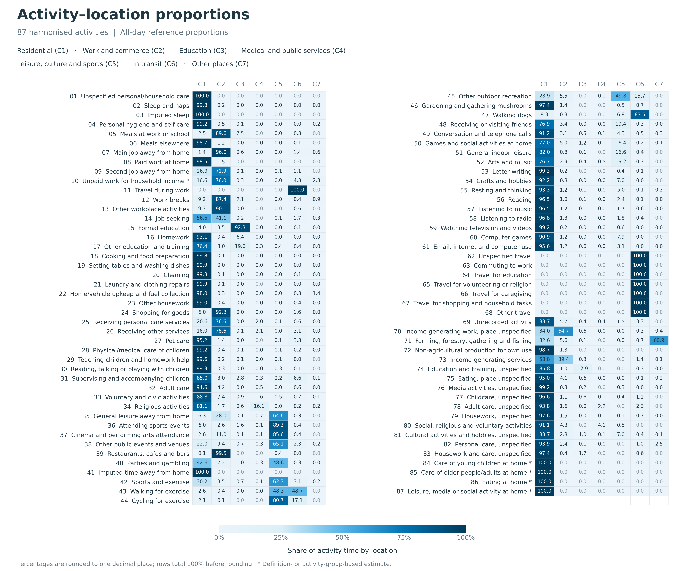

# Hourly location shares: data sources and methods

Hourly location shares describe the population distribution among seven location classes throughout the day. They are derived from time-use surveys, published activity tables and household travel diaries, with day-type transfer and demographic adjustments. This report describes the data sources, calculation methods and application in GlobalDynPop. The supplied Stage 2 tables are stored in [demo/stage_2/hourly_location_shares/](../demo/stage_2/hourly_location_shares).

The companion [indoor-share guide](../w_indoor/w_indoor.md) documents the separate W_indoor parameter, its sources and assignment to cities.

## Contents

- [1. What the 24-by-7 matrix represents](#1-what-the-24-by-7-matrix-represents)
- [2. Diary records to weighted hourly shares](#2-diary-records-to-weighted-hourly-shares)
  - [2.1 Harmonise activities and locations](#21-harmonise-activities-and-locations)
  - [2.2 Split and aggregate diary minutes by hour](#22-split-and-aggregate-diary-minutes-by-hour)
  - [2.3 Construct the activity–location proportion table](#23-construct-the-activitylocation-proportion-table)
  - [2.4 Allocate unresolved locations and calculate hourly shares](#24-allocate-unresolved-locations-and-calculate-hourly-shares)
- [3. From published activity statistics to hourly location shares](#3-from-published-activity-statistics-to-hourly-location-shares)
  - [3.1 When hourly activity shares are available](#31-when-hourly-activity-shares-are-available)
  - [3.2 When only daily activity durations are available](#32-when-only-daily-activity-durations-are-available)
- [4. Constructing workday and rest-day profiles](#4-constructing-workday-and-rest-day-profiles)
  - [4.1 When national day-type data are available](#41-when-national-day-type-data-are-available)
  - [4.2 When only a national average-day profile is available](#42-when-only-a-national-average-day-profile-is-available)
  - [4.3 Reference countries and missing baselines](#43-reference-countries-and-missing-baselines)
- [5. Deriving hourly location shares from travel surveys](#5-deriving-hourly-location-shares-from-travel-surveys)
  - [5.1 Infer where each person stays between trips](#51-infer-where-each-person-stays-between-trips)
  - [5.2 Combine individual records into hourly population shares](#52-combine-individual-records-into-hourly-population-shares)
  - [5.3 Estimate day types missing from the travel data](#53-estimate-day-types-missing-from-the-travel-data)
- [6. Profile adjustments](#6-profile-adjustments)
  - [6.1 Lunch-hour locations](#61-lunch-hour-locations)
  - [6.2 School-age children](#62-school-age-children)
  - [6.3 Timing calibration](#63-timing-calibration)
- [7. Data sources](#7-data-sources)

## 1. What the 24-by-7 matrix represents

Each country and day type has a matrix of 24 local clock hours and seven location classes. Its entry sc(h, t) is the estimated population share in class c during hour h on day type t. Workday and rest-day matrices are stored separately.

| Class | CSV column | Meaning |
| --- | --- | --- |
| C1 | residential | Residential places |
| C2 | commercial_industrial | Workplaces, commerce and industry |
| C3 | education | Education places |
| C4 | medical_public | Medical and public-service places |
| C5 | leisure | Leisure, cultural and sports places |
| C6 | transportation | People in transit |
| C7 | other | Other places |

```math
\sum_{c=1}^{7}s_c(h,t)=1,\qquad 0\leq s_c(h,t)\leq 1.
```

Shares range from zero to one; 0.10 represents 10% of the population. Summing a class over 24 hours gives its mean daily hours per person, and the full matrix sums to 24 hours.

National temporal profiles determine the hourly population shares, while city-specific spatial layers allocate these shares within each modelled city.

### How to read this guide

Sections 2–6 describe the calculation methods and adjustments. Section 7 lists the data sources.

The model uses the completed profiles. Their construction draws on the surveys, classification crosswalks and harmonised reference tables described below.

## 2. Diary records to weighted hourly shares

National time-use survey records are processed in four steps: harmonise activities and locations, split episodes into hourly weighted minutes, construct the pooled activity–location proportion table, and use that table to allocate unresolved locations before calculating hourly population shares.

### 2.1 Harmonise activities and locations

Original survey activity codes are mapped to 87 common activities, and reported locations are mapped to the seven classes C1–C7. Records with missing locations and those known to occur away from home but without a specific location class are retained separately. An unspecified “other” location is classified as a leisure place when the recorded activity is leisure-related.

The 87-category activity list extends the 69-category **Multinational Time Use Study (MTUS)** framework with 14 categories used to harmonise additional national survey activities (codes 70–83) and four explicitly home-based categories (codes 84–87). The [MTUS main-activity classification](https://www.mtusdata.org/mtus-action/variables/MAIN) provides the basis for codes 1–69. Codes 70–83 bring together source activities from time-use surveys in Albania (2010–2011), the United Kingdom (2014–2015), Ghana (2009), India (2019), Nigeria (2024), Vietnam (2022), Pakistan (2007), Canada (2022) and the United States (2025). They retain distinctions such as agricultural production, income-generating services, and broadly reported education, care and media activities. The activity list below identifies the countries whose original codes map to each added category.

#### Complete list of the 87 harmonised activities

Codes 1–69 follow the MTUS-based framework. For codes 70–83, the source column lists countries with matching entries in the original survey-code crosswalk. Codes 84–87 use explicit home-location definitions.

| Code | Activity | Classification or mapped survey countries |
| --- | --- | --- |
| 1 | Unspecified personal/household care | MTUS |
| 2 | Sleep and naps | MTUS |
| 3 | Imputed sleep | MTUS |
| 4 | Personal hygiene and self-care | MTUS |
| 5 | Meals at work or school | MTUS |
| 6 | Meals elsewhere | MTUS |
| 7 | Main job away from home | MTUS |
| 8 | Paid work at home | MTUS |
| 9 | Second job away from home | MTUS |
| 10 | Unpaid work for household income | MTUS |
| 11 | Travel during work | MTUS |
| 12 | Work breaks | MTUS |
| 13 | Other workplace activities | MTUS |
| 14 | Job seeking | MTUS |
| 15 | Formal education | MTUS |
| 16 | Homework | MTUS |
| 17 | Other education and training | MTUS |
| 18 | Cooking and food preparation | MTUS |
| 19 | Setting tables and washing dishes | MTUS |
| 20 | Cleaning | MTUS |
| 21 | Laundry and clothing repairs | MTUS |
| 22 | Home/vehicle upkeep and fuel collection | MTUS |
| 23 | Other housework | MTUS |
| 24 | Shopping for goods | MTUS |
| 25 | Receiving personal care services | MTUS |
| 26 | Receiving other services | MTUS |
| 27 | Pet care | MTUS |
| 28 | Physical/medical care of children | MTUS |
| 29 | Teaching children and homework help | MTUS |
| 30 | Reading, talking or playing with children | MTUS |
| 31 | Supervising and accompanying children | MTUS |
| 32 | Adult care | MTUS |
| 33 | Voluntary and civic activities | MTUS |
| 34 | Religious activities | MTUS |
| 35 | General leisure away from home | MTUS |
| 36 | Attending sports events | MTUS |
| 37 | Cinema and performing arts attendance | MTUS |
| 38 | Other public events and venues | MTUS |
| 39 | Restaurants, cafes and bars | MTUS |
| 40 | Parties and gambling | MTUS |
| 41 | Imputed time away from home | MTUS |
| 42 | Sports and exercise | MTUS |
| 43 | Walking for exercise | MTUS |
| 44 | Cycling for exercise | MTUS |
| 45 | Other outdoor recreation | MTUS |
| 46 | Gardening and gathering mushrooms | MTUS |
| 47 | Walking dogs | MTUS |
| 48 | Receiving or visiting friends | MTUS |
| 49 | Conversation and telephone calls | MTUS |
| 50 | Games and social activities at home | MTUS |
| 51 | General indoor leisure | MTUS |
| 52 | Arts and music | MTUS |
| 53 | Letter writing | MTUS |
| 54 | Crafts and hobbies | MTUS |
| 55 | Resting and thinking | MTUS |
| 56 | Reading | MTUS |
| 57 | Listening to music | MTUS |
| 58 | Listening to radio | MTUS |
| 59 | Watching television and videos | MTUS |
| 60 | Computer games | MTUS |
| 61 | Email, internet and computer use | MTUS |
| 62 | Unspecified travel | MTUS |
| 63 | Commuting to work | MTUS |
| 64 | Travel for education | MTUS |
| 65 | Travel for volunteering or religion | MTUS |
| 66 | Travel for caregiving | MTUS |
| 67 | Travel for shopping and household tasks | MTUS |
| 68 | Other travel | MTUS |
| 69 | Unrecorded activity | MTUS |
| 70 | Income-generating work, place unspecified | Albania, Canada, United Kingdom, Ghana, India, Nigeria, Pakistan, United States, Vietnam |
| 71 | Farming, forestry, gathering and fishing | Albania, United Kingdom, Ghana, India, Nigeria, Pakistan, Vietnam |
| 72 | Non-agricultural production for own use | India, Nigeria |
| 73 | Income-generating services | Ghana, India, Nigeria, Pakistan, Vietnam |
| 74 | Education and training, unspecified | Canada, Ghana, India, Nigeria, Pakistan, Vietnam |
| 75 | Eating, place unspecified | Albania, Canada, United Kingdom, Ghana, India, Nigeria, Pakistan, Vietnam |
| 76 | Media activities, unspecified | Canada, United Kingdom, Ghana, India, Nigeria, Pakistan, Vietnam |
| 77 | Childcare, unspecified | Albania, Canada, United Kingdom, India, Nigeria, Vietnam |
| 78 | Adult care, unspecified | Albania, Canada, United Kingdom, India, Nigeria, Vietnam |
| 79 | Housework, unspecified | Canada, United Kingdom, Ghana, India, Nigeria, Pakistan, United States, Vietnam |
| 80 | Social, religious and voluntary activities | Canada, India, Nigeria |
| 81 | Cultural activities and hobbies, unspecified | Canada, United Kingdom, Ghana, India, Nigeria, Pakistan, United States, Vietnam |
| 82 | Personal care, unspecified | Canada, Ghana, India, Nigeria, Pakistan, Vietnam |
| 83 | Housework and care, unspecified | United Kingdom, Ghana, India, Nigeria, Pakistan, Vietnam |
| 84 | Care of young children at home | Explicit home-location definition |
| 85 | Care of older people/adults at home | Explicit home-location definition |
| 86 | Eating at home | Explicit home-location definition |
| 87 | Leisure, media or social activity at home | Explicit home-location definition |

### 2.2 Split and aggregate diary minutes by hour

Each diary episode is split at clock-hour boundaries, including midnight. For example, an episode from 08:40 to 09:20 contributes 20 minutes to 08:00–09:00 and 20 minutes to 09:00–10:00. Each contribution is multiplied by the diary record's survey weight, then summed by hour, activity and location status:

```math
M(h,a,z)=\sum_e w_e\,\mathrm{overlap\_minutes}(e,h)\,\mathbf{1}(a_e=a,\ z_e=z).
```

Here e is an episode, h a local clock hour, a an activity, z a classified or unresolved location status, and w_e the diary record's survey weight. Weights can differ because of sampling probabilities, response rates, and population or diary-date composition; their definitions follow each survey. The same record weight applies throughout an episode, including portions with unresolved locations.

This step produces weighted minutes. Classified-location minutes supply the reference proportions in Section 2.3; classified and unresolved minutes both enter the country-profile calculation in Section 2.4.

### 2.3 Construct the activity–location proportion table

The proportion table is compiled from actual national time-use survey records pooled across countries, retaining the weighting used for each survey. After the hourly aggregation in Section 2.2, classified minutes are pooled by activity, hour and location class. Let R(h,a,c) denote these pooled reference minutes. The hourly table is calculated as:

```math
GF(h,a,c)=\frac{R(h,a,c)}{\sum_{k=1}^{7}R(h,a,k)}.
```

Thus, each activity–hour row contains seven location proportions summing to one, giving 87 × 24 rows. For illustration, 60 weighted minutes in residential places and 40 in education places give proportions of 0.60 and 0.40 for that activity and hour.

The all-day table combines the reference minutes across hours before calculating the proportions:

```math
GF_{\mathrm{day}}(a,c)=\frac{\sum_{h=0}^{23}R(h,a,c)}{\sum_{h=0}^{23}\sum_{k=1}^{7}R(h,a,k)}.
```

The heatmap below displays this all-day table. The hourly table is used to allocate unresolved locations in Section 2.4 and to convert published activity shares into location shares in Section 3. Where activity-specific hourly location records are unavailable, the supplied reference tables use the activity's all-day distribution, an explicit location definition, or a broader activity-group distribution. In the all-day table, codes 10 and 84–87 use definition- or group-based estimates.



*Figure 1. All-day activity–location proportions compiled from national time-use survey records pooled across countries, for 87 harmonised activities and seven location classes. Rows sum to one and use a common linear colour scale from 0 to 100%. Codes marked with an asterisk (10 and 84–87) use definition- or activity-group-based estimates. Values are from the all-day activity–location reference table; all seven percentages are rounded to one decimal place. Displayed totals may differ slightly from 100% because of rounding.*

### 2.4 Allocate unresolved locations and calculate hourly shares

For each country and day type, let K(h,a,c) be the weighted minutes already assigned to a location class. Let U8(h,a) be minutes with missing locations, and U7(h,a) minutes known to occur away from home but without a specific location class.

Missing-location minutes are distributed across C1–C7 using GF. For unresolved away-from-home minutes, the residential proportion is set to zero and the remaining six proportions are renormalised to form GF_nonres. If their sum is zero, these minutes are assigned to other places (C7). The completed minutes are:

```math
J(h,a,c)=K(h,a,c)+U_8(h,a)GF(h,a,c)+U_7(h,a)GF_{\mathrm{nonres}}(h,a,c).
```

Finally, minutes are summed across activities and divided by all weighted diary minutes in that hour:

```math
L(h,c)=\frac{\sum_a J(h,a,c)}{D(h)},\qquad
D(h)=\sum_a\left[\sum_{k=1}^{7}K(h,a,k)+U_8(h,a)+U_7(h,a)\right].
```

For complete diaries, D(h) equals 60 times the sum of diary weights in the country/day-type group. Each hour requires a positive denominator. The result is a 24 × 7 population-share matrix, with each hourly row summing to one.

## 3. From published activity statistics to hourly location shares

Some countries publish statistics on when people undertake activities or how much time they spend on them each day. These statistics are converted into hourly population shares in the seven location classes using the activity–location proportion table from Section 2.3. The calculation follows two routes, depending on the available time detail.

### 3.1 When hourly activity shares are available

The input is the population share undertaking each activity during each hour. Subhourly observations are first averaged within clock hours: for example, four equal-length 15-minute slots each receive a weight of one quarter. The published estimates retain their survey weighting, and the resulting hourly activity shares are normalised to sum to one.

Each activity share is multiplied by its proportions in the seven location classes. For illustration, suppose 10% of the population is studying during an hour, and the corresponding reference proportions are 20% residential and 80% education. Studying then contributes 2% of the population to residential places and 8% to education places. Repeating this calculation for all activities and summing their contributions gives the hourly location shares.

If a published activity group contains several fine activities, its share is first divided among them using their relative durations in the pooled reference data at that hour. Here A(h,g) is the published share for group g, GM(h,a) is the reference duration for fine activity a, and S(h,a) is the resulting fine-activity share. GF(h,a,c) is the activity–location proportion defined in Section 2.3:

```math
\begin{aligned}
S(h,a)&=A(h,g)\frac{GM(h,a)}{\sum_{a'\in g}GM(h,a')},\\
L(h,c)&=\sum_a S(h,a)GF(h,a,c).
\end{aligned}
```

If a group's reference durations sum to zero, its share is divided equally among its fine activities. The final location shares are normalised within each hour, producing a 24 × 7 matrix.

### 3.2 When only daily activity durations are available

The input is the mean daily time spent on each activity group. These totals provide the amount of time, while an hourly activity profile from a reference country supplies its initial distribution across the day. For illustration, a target of eight hours of work per day constrains the total area under the hourly work curve; the reference profile supplies the initial timing of that work.

The reference profile is adjusted to reproduce the target country's daily activity durations while keeping the activity shares in each hour equal to one. This is done by iterative proportional fitting: alternately scale each activity group's hourly values to its daily target and renormalise each hourly row. With A(h,g) denoting the adjusted group share, the constraints are:

```math
\sum_g A(h,g)=1\quad\text{for each }h,\qquad
60\sum_{h=0}^{23}A(h,g)=\mathrm{target\_minutes}(g)\quad\text{for each }g.
```

Daily targets are harmonised to the common activity groups and a complete 24-hour budget. Once the hourly activity profile is fitted, it follows Section 3.1: split broad groups into fine activities, apply the activity–location proportions, and sum by location class. Where several timing references are specified, their reconstructed fine-activity profiles are averaged equally before the location conversion. Each source retains its average-day definition.

Fitting stops when the largest daily-duration error is below 10⁻⁷ minutes, checked every 10 iterations, with a maximum of 12,000 iterations. A zero target removes its activity group; unsupported positive targets, empty hours or non-convergence cause an error. These numerical settings and the equal weighting of reference profiles are study-defined choices.

## 4. Constructing workday and rest-day profiles

The preceding sections construct hourly population shares in the seven location classes. This step distinguishes workdays from rest days. The method depends on whether the country has its own day-type data or only an average-day profile.

### 4.1 When national day-type data are available

Diary records are grouped by their survey day, and hourly location shares are calculated separately for each group using Section 2. Published workday and rest-day activity tables are processed separately using Section 3.

Day types follow the source survey. Where date or holiday fields are used, the designated weekend days and recorded public holidays form the rest-day group. Separate diary groups normally require at least 100 records, with source-specific thresholds; a non-empty pooled group can still provide an average-day profile.

### 4.2 When only a national average-day profile is available

The country's average-day profile supplies the baseline for every hour and location class. Reference countries supply the relative change from an average day to a workday or rest day. For each reference country, this change is calculated as its day-type share divided by its average-day share. When several references are used, their ratios are averaged equally.

For illustration, consider a simplified two-location example at 10:00:

| Location | Target country: average day | Reference country: average day | Reference country: workday | Workday multiplier |
| --- | ---: | ---: | ---: | ---: |
| Residential | 60% | 50% | 40% | 0.8 |
| Workplaces | 40% | 50% | 60% | 1.2 |

Applying these multipliers to the target country gives 48% for residential places and 48% for workplaces. Dividing both by their 96% total gives workday shares of 50% and 50%. Rest-day shares are calculated using the reference country's rest-day multipliers. In the model, this calculation is repeated for all 24 hours and all seven location classes.

Let B_X(h,c) be the target country's average-day share, L_d(h,c,t) the share in reference country d on day type t, and L_d(h,c,all) its average-day share. The mean multiplier and resulting target share are:

```math
\begin{aligned}
r_t(h,c)&=\frac{1}{N}\sum_{d=1}^{N}\frac{L_d(h,c,t)}{L_d(h,c,\mathrm{all})},\\
L_X(h,c,t)&=\frac{B_X(h,c)r_t(h,c)}{\sum_{k=1}^{7}B_X(h,k)r_t(h,k)}.
\end{aligned}
```

Here N is the number of reference countries. A reference ratio is set to one when its average-day share is at most 10⁻⁶. The calculation preserves the target country's baseline as the starting point and applies the reference day-type contrasts to it. For selected countries, the same procedure uses contrasts from their own day-type records to adjust an existing national baseline.

### 4.3 Reference countries and missing baselines

Reference countries are selected using the study's regional grouping:

| Region | Reference countries |
| --- | --- |
| North America | United States, Canada |
| Latin America | Mexico, Colombia, Peru, Paraguay |
| Western Europe | United Kingdom, Spain, Belgium |
| Eastern Europe and Central Asia | Russia, Albania |
| East Asia | Japan, Republic of Korea, China |
| South Asia | India, Pakistan |
| Southeast Asia | China, India |
| Middle East and North Africa | Morocco |
| Sub-Saharan Africa | Ghana, Nigeria, South Africa |
| Oceania | Australia |

If the target country also lacks an average-day profile, the mean of the reference countries' average-day profiles supplies its baseline. Separate Saturday and Sunday profiles are transferred only when every selected reference provides the required curves.

Each day-type profile is normalised independently. Where the school adjustment in Section 6.2 changes a workday profile, the average-day profile is subsequently recomputed. Regional grouping, reference selection and equal weighting are study-defined choices.

## 5. Deriving hourly location shares from travel surveys

The model needs to know what share of the population is at home, at activity destinations or in transit during each hour. The preceding sections estimate these shares from records of people's activities. Travel surveys provide another route to the same result: departure and arrival times identify periods spent travelling, while destinations indicate where people stay between trips.

For the United States, Mexico and Brazil, the adopted hourly shares are calculated from these travel records. Each person's day is reconstructed as a sequence of stays and journeys, and the records are combined using survey weights to estimate the population share in each location class. These estimates supply the three countries' final profiles in place of the initial time-use-based estimates.

### 5.1 Infer where each person stays between trips

The method follows each person's trips in time order. Time between departure and arrival is assigned to in-transit population (C6). After arrival, the person is assumed to remain at the destination until the next departure. The reported destination or trip purpose determines its location class.

For example, a person leaves home at 08:00, reaches work at 08:30, leaves work at 17:00 and returns home at 17:30. With no other trips recorded, the inferred day is:

| Time | Inferred location |
| --- | --- |
| Before 08:00 | Residential (C1) |
| 08:00–08:30 | In transit (C6) |
| 08:30–17:00 | Work and commerce (C2) |
| 17:00–17:30 | In transit (C6) |
| After 17:30 | Residential (C1) |

Before the first trip, the person is assigned to its reported origin, or to residential places when the origin is missing. People with no trips are assigned to home for the day. Visits to other households also belong to residential places (C1).

The day is represented by 144 ten-minute intervals. Departure times are rounded down and arrival times up to the nearest interval boundary. A trip whose recorded arrival time is earlier than its departure time is treated as crossing midnight; its in-transit period is retained up to the end of the modelled day.

### 5.2 Combine individual records into hourly population shares

At each ten-minute interval, the survey weights of people in a location class are added and divided by the total weight of all selected people, including those with no trips. A person's survey weight represents their contribution to the population covered by the survey. For illustration, if the weighted population totals 1,000 and the weighted number in transit is 100, the in-transit share is 10%.

The six interval shares within an hour are then averaged. This produces the same 24 × 7 location-share matrix as the time-use methods:

```math
\begin{aligned}
q(c,k)&=\frac{\sum_i w_i\,\mathbf{1}(\mathrm{location}_{i,k}=c)}{\sum_i w_i},\\
s(c,h)&=\frac{1}{6}\sum_{k\in h}q(c,k).
\end{aligned}
```

Here i identifies a person, w_i is their survey weight, k is a ten-minute interval, and c is a location class. The factor 1/6 averages time intervals; the person weights determine population representation.

The three adopted surveys and the populations included in the calculation are:

| Country and survey | Population and day types used |
| --- | --- |
| United States: [National Household Travel Survey (NHTS) 2017, Federal Highway Administration](https://nhts.ornl.gov/documentation) | Persons aged 5+ with a travel day, weighted by WTPERFIN. Separate weekday, rest-day, Saturday and Sunday profiles are calculated. |
| Mexico: [Encuesta Origen Destino en Hogares (EOD) 2017, INEGI](https://www.inegi.org.mx/rnm/index.php/catalog/533) | Valley of Mexico metropolitan survey, using the person-table weight `factor`. Travel records cover ages 6+; the population denominator includes household members of all ages, with children without trip records assigned to home. The selected inputs supply weekday and Saturday profiles. |
| Brazil: [Pesquisa Origem e Destino (OD) 2017, Companhia do Metropolitano de São Paulo](https://www.metro.sp.gov.br/pt_BR/metro/numeros-pesquisa/pesquisa-od/) | São Paulo metropolitan survey, using person weight FE_PESS to calculate a weekday profile. |

The resulting Mexican and Brazilian profiles are applied at country level in the model.

### 5.3 Estimate day types missing from the travel data

The selected surveys do not supply every required day type. The missing profiles are estimated using relative day-type changes from another travel survey, following the principle in Section 4:

- **Mexico Sunday:** start with Mexico's Saturday profile and apply the United States' Sunday-to-Saturday ratios. Mexico's rest-day profile is the mean of Saturday and the estimated Sunday.
- **Brazil rest day:** start with Brazil's weekday profile and apply Mexico's rest-day-to-weekday ratios. Separate Saturday and Sunday profiles use Mexico's corresponding ratios.

The ratios are applied separately to each hour and location class, then each hourly row is normalised to sum to one:

```math
\text{Estimated profile}=\mathrm{row\_normalise}\left[
\text{target base profile}\times
\frac{\text{reference profile for desired day type}+0.002}
{\text{reference profile for base day type}+0.002}
\right].
```

The added 0.002 stabilises ratios where shares are small. Average-day profiles combine five workdays, Saturday and Sunday for the United States and Mexico, and five workdays with two rest days for Brazil.

## 6. Profile adjustments

Three adjustments address inferred lunchtime locations, younger children missing from survey coverage, and differences between modelled and observed hourly timing. Their purposes and rules are summarised below.

### 6.1 Lunch-hour locations

When meal locations are inferred, some people eating at workplaces or schools may be assigned to residential places. To reduce a possible artificial lunchtime peak, residential shares at 12:00 and 13:00 are compared with a straight-line reference between 11:00 and 14:00. Any excess is transferred to non-residential classes, in proportion to their shortfalls below the same reference. If no appreciable shortfall exists, their current shares determine the allocation.

This study-defined rule changes only the two lunch hours and keeps each hourly total at one, although daily residential and non-residential totals change. It is applied separately to eligible day-type profiles, including Finland and Japan. The initial profiles for the United States, Canada, the United Kingdom, Spain, Albania, South Africa, Ghana, Nigeria, Pakistan and India are exempt because their diary processing uses location variables. The final travel-survey profiles for the United States, Mexico and Brazil also bypass this adjustment.

### 6.2 School-age children

Many time-use surveys exclude younger children, while the population model covers all ages. An estimated enrolled share for children aged 5–14 is therefore used to check the workday education peak:

```math
E=s_{5\text{--}9}p_{\mathrm{primary}}+
 s_{10\text{--}14}\frac{p_{\mathrm{primary}}+p_{\mathrm{secondary}}}{2}.
```

Here s denotes the age group's share of total population and p its enrolment proportion. Population and enrolment inputs come from the [World Bank World Development Indicators, with enrolment statistics supplied through UNESCO UIS](https://data.worldbank.org/indicator/SE.SEC.NENR).

If E exceeds the existing positive education peak, education shares are increased in proportion to the existing hourly education curve. The same amount is removed from residential shares, which must remain at least 5%. This retains the timing of school attendance while increasing its population share; the residential bound may prevent the peak from reaching E.

Only workdays are adjusted, and the other five location classes remain unchanged. The average-day profile is then rebuilt using five workdays and two rest days when a rest-day profile is available. The selected United States, Mexico and Brazil travel-survey profiles are exempt. Comparing enrolled children with peak education presence and averaging primary and secondary enrolment for ages 10–14 are study-defined assumptions.

### 6.3 Timing calibration

Hourly population observations from calibration cities in the United States, South Korea and Spain are used to test whether small changes in timing improve the profiles. The procedure shifts the work, service, leisure, transit and other-place curves later and adjusts their relative afternoon levels. Education timing remains fixed. Each changed curve is rescaled to preserve its daily total, and residential shares are calculated as the remainder, subject to being non-negative.

The best-scoring candidate is adopted only if it improves the mean calibration score by at least 0.25. The selected parameters are:

| Country / fitted day type | Delay (hours) | Afternoon weighting parameter | Profiles adjusted |
| --- | ---: | ---: | --- |
| United States / workday | 0 | 0 | None |
| United States / rest day | 0.5 | 0.1 | Rest day, Saturday, Sunday |
| South Korea / workday | 0.5 | 0.1 | Workday |
| South Korea / rest day | 0 | 0 | None |
| Spain / workday | 0.5 | 0.1 | Workday |

This calibration is not applied to the supplied Finland or Japan profiles.

**Processing order.** Survey harmonisation and day-type transfer are followed by lunch adjustment, travel-survey replacement, school adjustment and timing calibration. Transfers use the reference profiles available at that stage; Finland therefore uses Spain's profile before timing calibration.

## 7. Data sources

Country-specific day-type inputs cover 22 countries: 19 time-use survey sources and three travel-survey sources. Their forms range from diary records to published hourly rates and daily totals. The table identifies the adopted surveys and their use. The Mexican and Brazilian travel surveys cover metropolitan areas, and Nigeria's survey covers four states; their profiles are applied at country level.

| Country (ISO3) | Survey and provider | Survey year | Data used |
| --- | --- | --- | --- |
| Albania (ALB) | [Albania Time Use Survey, INSTAT](https://www.instat.gov.al/en/publications/books/2011/albania-time-use-survey-2010-2011/) | 2010-2011 | Activity/location diaries; weekday and weekend groups. |
| Australia (AUS) | [How Australians Use Their Time, Australian Bureau of Statistics](https://www.abs.gov.au/statistics/people/people-and-communities/how-australians-use-their-time/2024) | 2024 | Daily activity totals, ages 15+; hourly timing from Canada, Luxembourg and Norway. |
| Belgium (BEL) | [Statbel Time Use Survey](https://statbel.fgov.be/nl/themas/huishoudens/tijdsbudgetonderzoek), with historical [Multinational Time Use Study (MTUS)](https://www.timeuse.org/mtus) diaries | 2013 daily totals; 1966 timing | 2013 daily totals fitted to 1966 Belgian timing; day-type ratios applied to the national baseline. |
| Brazil (BRA) | [Pesquisa Origem e Destino, Companhia do Metropolitano de São Paulo](https://www.metro.sp.gov.br/pt_BR/metro/numeros-pesquisa/pesquisa-od/) | 2017 | São Paulo travel diaries for weekdays; rest-day ratios from Mexico. |
| Canada (CAN) | [Time Use Survey: Public Use Microdata File, Statistics Canada](https://www150.statcan.gc.ca/n1/en/catalogue/452500012025001) | 2022 | Weighted activity/location diaries; weekday, Saturday and Sunday groups. |
| China (CHN) | [National Time Use Survey bulletin, National Bureau of Statistics of China](https://www.stats.gov.cn/sj/zxfb/202302/t20230203_1900224.html) | 2018 | Workday/rest-day activity totals; timing from Mongolia, Republic of Korea and Japan, applied to the urban baseline. |
| Colombia (COL) | [Encuesta Nacional de Uso del Tiempo (ENUT), DANE](https://microdatos.dane.gov.co/index.php/catalog/552) | 2016-2017 | Weekday/weekend daily totals; hourly timing from Argentina. |
| Ghana (GHA) | [Ghana Time Use Survey, Ghana Statistical Service](https://microdata.statsghana.gov.gh/index.php/catalog/53) | 2009 | Weighted activity/location diaries; weekday, Saturday and Sunday groups. |
| India (IND) | [Time Use Survey, National Statistical Office](https://www.mospi.gov.in/time-use-survey) | 2019 | Urban activity/location diaries, ages 10+; Sunday is the rest day, Saturday a workday. |
| Japan (JPN) | [Survey on Time Use and Leisure Activities, Questionnaire A, Statistics Bureau of Japan](https://www.stat.go.jp/english/data/shakai/2016/gaiyo.html) | 2016 | 15-minute activity participation tables, ages 15+; weekday, Saturday and Sunday profiles. |
| Mexico (MEX) | [Encuesta Origen Destino en Hogares (EOD), INEGI](https://www.inegi.org.mx/rnm/index.php/catalog/533) | 2017 | Valley of Mexico travel diaries for weekdays and Saturday; Sunday estimated using United States ratios. |
| Morocco (MAR) | [Enquête Nationale sur l'Emploi du Temps (ENET), Haut-Commissariat au Plan](https://www.hcp.ma/Enquete-Nationale-sur-l-Emploi-du-Temps-ENET-2012_a2947.html) | 2011-2012 | Weekday/weekend daily totals; hourly timing from South Africa and Ghana. |
| Nigeria (NGA) | [Nigeria Time Use Survey, National Bureau of Statistics](https://microdata.nigerianstat.gov.ng/index.php/catalog/178) | 2024 survey | Weighted activity/location diaries from four states; weekday, Saturday and Sunday groups. |
| Pakistan (PAK) | [Time Use Survey, Pakistan Bureau of Statistics](https://www.pbs.gov.pk/sites/default/files/other/tus2007.pdf) | 2007 | Activity/location diaries; Sundays and flagged holidays are rest days, Saturday a workday. |
| Paraguay (PRY) | [Encuesta del Uso del Tiempo (EUT), INE (formerly DGEEC)](https://anda.ine.gov.py/anda/index.php/catalog/183) | 2016 | Weekday/weekend daily totals; hourly timing from Argentina. |
| Peru (PER) | [Encuesta Nacional de Uso del Tiempo (ENUT), INEI](https://www.inei.gob.pe/media/MenuRecursivo/publicaciones_digitales/Est/Lib2010/libro.pdf) | 2024 | 10-minute activity participation tables for urban residents aged 12+; weekday, Saturday and Sunday groups. |
| Republic of Korea (KOR) | [Time Use Survey, Statistics Korea / KOSIS](https://kosis.kr/statHtml/statHtml.do?orgId=101&tblId=DT_2019_070) | 2024 | Published activity timing tables DT_2019_070 and DT_2019_071, ages 10+; weekday, Saturday and Sunday groups. |
| Russia (RUS) | [Selective Observation of Daily Time Use, Rosstat](https://www.rosstat.gov.ru/free_doc/new_site/population/urov/sut_fond24/index.html); source files obtained through the [Tochno.st survey archive](https://tochno.st/datasets/surveys) | 2024 | Weekday/weekend daily totals; hourly timing from Bulgaria, Romania and Hungary. |
| South Africa (ZAF) | [Time Use Survey, Statistics South Africa](https://www.statssa.gov.za/publications/Report-02-02-00/Report-02-02-002010.pdf) | 2010 | Weighted activity/location diaries; weekday, Saturday and Sunday groups. |
| Spain (ESP) | [Encuesta de Empleo del Tiempo (EET), INE](https://www.ine.es/dyngs/INEbase/es/operacion.htm?c=Estadistica_C&cid=1254736176815&idp=1254735976608&menu=resultados) | 2009-2010 | Activity/location diaries; weekday, Saturday and Sunday groups. |
| United Kingdom (GBR) | [UK Time Use Survey, Centre for Time Use Research / UK Data Service SN 8128](https://timeuse.org/uk-time-use-survey-2014-2015) | 2014-2015 | Weighted activity/location diaries; weekday, Saturday and Sunday groups. |
| United States (USA) | [National Household Travel Survey (NHTS), Federal Highway Administration](https://nhts.ornl.gov/documentation) | 2017 | Household travel diaries, ages 5+; weekday, Saturday and Sunday profiles. |

The United States American Time Use Survey and Mexico's National Time Use Survey (ENUT) also contribute reference information earlier in processing; their final country profiles use the travel surveys listed above. Finland uses transferred day-type contrasts and is outside this 22-country group.

**School data.** World Bank indicators: `SP.POP.TOTL`, `SP.POP.0509.MA/FE`, `SP.POP.1014.MA/FE`, `SE.PRM.TENR` and `SE.SEC.NENR`; gross enrolment indicators `SE.PRM.ENRR` and `SE.SEC.ENRR` provide fallbacks. Use each series' latest non-missing archived value and cap enrolment at 100%. Missing age shares use regional, then global medians; remaining enrolment gaps use global medians.
