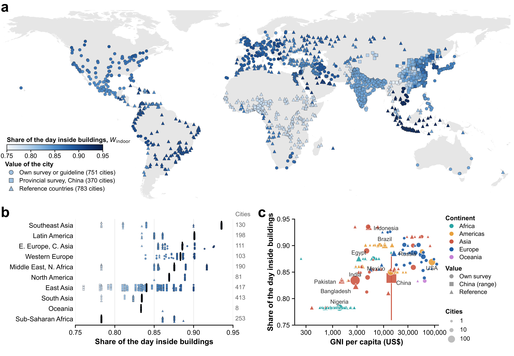
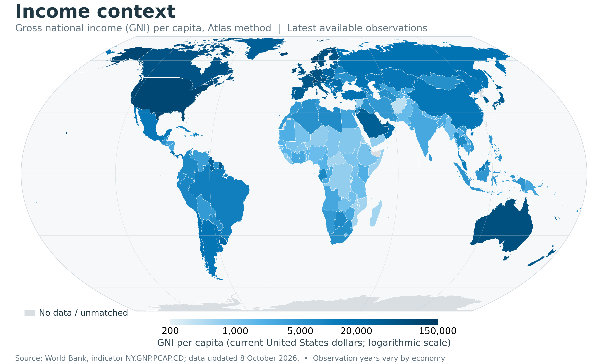
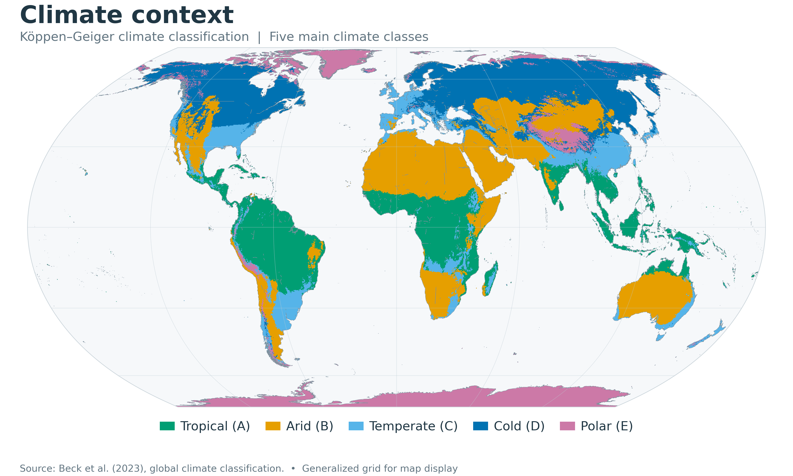

# Indoor time share (W_indoor): data sources and methods

`W_indoor` is the share of a 24-hour day spent inside buildings. GlobalDynPop uses this parameter to divide destinations away from home between buildings and nearby open space. This report documents the data sources, calculation conventions and city-assignment method used by GlobalDynPop.

## 1. Adopted values across the study cities

The study assigns a value to each of its **1,904 urban centres**. A city receives a provincial value in mainland China, an adopted national or city-survey value where one is available for its country or territory, or a value transferred from selected reference countries. Figure 1 shows their global and regional distributions and their relationship with gross national income (GNI) per capita.

*Figure 1. Adopted indoor time shares across 1,904 urban centres. (a) City values, coloured by W_indoor: circles indicate domestic surveys or guidelines (751 cities), squares indicate Chinese assignments (370 cities, including the Hong Kong survey and provincial fallback assignments), and triangles indicate international reference matching (783 cities). (b) City values by region; black bars mark regional medians and numbers give city counts. E. Europe, C. Asia and N. Africa denote Eastern Europe, Central Asia and North Africa. (c) Country-level median city values versus gross national income (GNI) per capita, Atlas method, in current United States dollars (US$), on a logarithmic income axis. Colours identify continents, symbol sizes indicate city counts, and the vertical line for China shows the range of assigned city values. USA denotes the United States.*

## 2. From source records to an indoor share

### Definition and denominator

For a source reporting daily indoor time in minutes,

$$
W_{\mathrm{indoor}}=\frac{T_{\mathrm{inside\ buildings}}}{1440}.
$$

The corresponding denominator is 24 when time is reported in hours. Time in vehicles is excluded from the indoor numerator where the source identifies it separately. Each value describes the population, observation period and day type covered by its source. A published mean or median is converted to a fraction of the day without an additional weighting step; a median is not converted into a population mean. Where individual diary records are aggregated, the calculation below distinguishes recorded durations from survey weights.

| Available information | Calculation | Interpretation |
|---|---|---|
| Diary episodes with explicit indoor/outdoor codes | Sum indoor minutes within each person-day; calculate the mean across person-days using the applicable diary survey weights, then divide by 1,440. Use equal weights only for an explicitly unweighted estimate. | Direct classification of recorded time. |
| Time by place | Sum time at home, workplaces and schools, other dwellings, restaurants and shops; divide by 1,440 minutes. | A location-based estimate; all other places and travel remain outside the indoor numerator. |
| Published indoor mean or median | Divide the published duration by 24 hours or 1,440 minutes, or use the published proportion. | Preserve the distinction between means and medians. |
| Reported outdoor time | Use `(24 − outdoor hours) / 24` where this is the adopted source calculation. | A complement-based estimate whose meaning depends on the source's outdoor and travel definitions. |
| Exposure guideline or activity-based estimate | Use the stated guideline duration or the source's identified indoor activities. | Retain its evidence category; it is not a directly observed city-wide indoor/outdoor diary. |

### Survey weighting

For each complete daily diary `d`, let `T_d,indoor` be total indoor minutes and `q_d` the survey agency's record weight:

$$
W_{\mathrm{indoor}}=
\frac{\sum_d q_d T_{d,\mathrm{indoor}}}{1440\sum_d q_d}.
$$

Weights may adjust for unequal sampling probabilities, response rates, and population or diary-date composition. They reflect population representation, not activity importance; their construction is survey-specific.

This formula applies to diary-derived means. Published statistics are used without reweighting; selected reference countries are averaged equally (Section 4).

Source day-type definitions are retained. Because unclassified or in-vehicle time may fall outside the indoor numerator, `1 − W_indoor` is not necessarily outdoor time alone.

### Interpreting heterogeneous sources

The evidence combines national time-use surveys, urban exposure studies, provincial medians, questionnaires and an exposure guideline. For example, the Finnish estimate comes from EXPOLIS Helsinki, Japan uses the 2016 Survey on Time Use and Leisure Activities, and mainland China uses adult provincial medians from the Chinese Exposure Factors Handbook. A national assignment based on a city study remains a city-study estimate applied nationally; its coverage should not be confused with national survey representativeness. Full references and sampled populations are listed in Section 5.

## 3. Provincial assignment in China

For mainland Chinese cities, the urban-centre location identifies the province. The province's median daily indoor time from the 2011–2012 adult exposure survey is divided by 1,440 minutes. The adopted rules are:

1. Use the reported provincial median when available.
2. For a province without a reported value, use the mean of the adjacent provinces.
3. For an island without a reported value, use the nearest province across the strait.
4. Hong Kong uses its own adopted survey, Tu (2005), rather than a mainland provincial value.

These are provincial adult medians assigned to cities, not city-specific population means. When **China is a reference for another country**, it contributes **one national reference**, using the reported national mean of **1,167 minutes/day**, equivalent to `1167 / 1440 ≈ 0.8104`. The provincial medians are not separate international donor candidates. [Duan et al. (2015)](https://doi.org/10.1016/B978-0-12-803125-4.00015-8).

### Reported provincial inputs

| Province | Indoor time (min/day) | W_indoor |
| --- | --- | --- |
| Anhui | 1,210 | 0.840 |
| Beijing | 1,220 | 0.847 |
| Chongqing | 1,235 | 0.858 |
| Fujian | 1,241 | 0.862 |
| Gansu | 1,095 | 0.760 |
| Guangdong | 1,200 | 0.833 |
| Guangxi | 1,140 | 0.792 |
| Guizhou | 1,195 | 0.830 |
| Hebei | 1,233 | 0.856 |
| Heilongjiang | 1,202 | 0.835 |
| Henan | 1,125 | 0.781 |
| Hubei | 1,166 | 0.810 |
| Hunan | 1,208 | 0.839 |
| Inner Mongolia | 1,174 | 0.815 |
| Jiangsu | 1,260 | 0.875 |
| Jiangxi | 1,196 | 0.831 |
| Jilin | 1,273 | 0.884 |
| Liaoning | 1,230 | 0.854 |
| Ningxia | 1,247 | 0.866 |
| Qinghai | 1,230 | 0.854 |
| Shandong | 1,247 | 0.866 |
| Shanghai | 1,264 | 0.878 |
| Shanxi | 1,190 | 0.826 |
| Sichuan | 1,170 | 0.812 |
| Tianjin | 1,204 | 0.836 |
| Tibet | 1,067 | 0.741 |
| Xinjiang | 1,145 | 0.795 |
| Yunnan | 1,095 | 0.760 |
| Zhejiang | 1,230 | 0.854 |

*Provincial indoor times are from Duan et al. (2015); proportions are displayed to three decimal places. The table includes provinces with no study city and therefore does not define the range of city values plotted in Figure 1.*

## 4. Assignment where an adopted domestic source is unavailable

An adopted domestic source takes precedence over international matching. Only cities without such a source enter the reference-selection procedure. The matching uses continuous GNI per capita, geographic proximity in regional groupings, evidence grade and climate class.

### Income and climate inputs

**Income.** Economic similarity between target and reference countries was assessed using World Bank gross national income (GNI) per capita, calculated using the Atlas method and expressed in current United States dollars (indicator `NY.GNP.PCAP.CD`). The latest available observation for each economy in the archived dataset was used, so reference years varied across economies. Matching used continuous GNI ratios rather than income-group categories. [World Bank](https://data.worldbank.org/indicator/NY.GNP.PCAP.CD).

*Figure 2. Gross national income (GNI) per capita, Atlas method, in current United States dollars, using the original World Bank observations retained in the archived country table. Colours use a logarithmic scale. Economies without an original observation or an exact geographic join are grey; imputed matching values are not presented as observed income. The latest available year differs by economy. Equal Earth projection; Natural Earth geographic context.*

**Climate.** Climate information comes from the Beck et al. Köppen–Geiger classification, version 2, 1991–2020, at approximately 1-km resolution. Climate is represented by the main classes **tropical (A), arid (B), temperate (C), cold (D) and polar (E)**. The source raster and its accompanying legend are used for the contextual map below. The current assignment treats the main climate class as the final ranking criterion after income, geography and evidence. [Beck et al. (2023)](https://doi.org/10.1038/s41597-023-02549-6); [Köppen–Geiger classification dataset](https://doi.org/10.6084/m9.figshare.21789074).

*Figure 3. Main Köppen–Geiger climate classes derived from the source climate raster using its original class legend: codes 1–3 become A, 4–7 B, 8–16 C, 17–28 D and 29–30 E. The raster is sampled by nearest neighbour to a 1,440 × 720 display grid before grouping for this global overview; this display grid is not used to recompute city climate classes or W_indoor. Unclassified pixels are uncoloured. Equal Earth projection.*

### Evidence grades

| Grade | Definition |
|---|---|
| 0 | A nationally representative survey since 2000, or a large population-based survey of the main city since 2000. |
| 1 | A survey before 2000, an EXPOLIS city sample, an exposure guideline, or an indirect estimate from indoor activities. |
| 2 | A special population group or a small sample. |

These study-defined grades summarise source type, survey period and population coverage for reference selection; they are not a standardised evidence rating or a measure of statistical uncertainty. A source can still be adopted for its own country when its grade is 1 or 2. Evidence type, survey coverage and grade should therefore be read together.

### Reference selection

Let `g_c` be the target country's GNI per capita and `g_r` the GNI of a reference country. Define the symmetric income ratio

$$
R(c,r)=\max\left(\frac{g_c}{g_r},\frac{g_r}{g_c}\right).
$$

1. **Choose the first non-empty income tier:** `R ≤ 2`; otherwise `R ≤ 3`; otherwise `R ≤ 5`; otherwise allow any income ratio.
2. **Within that tier, prefer geographic proximity:** the same United Nations (UN) sub-region, then the same continent, then another continent.
3. **Prefer the stronger evidence grade** within that geographic level: grade 0 before grade 1 before grade 2.
4. **Order the remaining candidates by closest income**, then preference for the same Köppen–Geiger main class.
5. **Average up to three references** sharing the best candidate's income tier, geographic level and evidence grade. Where more than three qualify, retain the first three in the ranking. In the final, unbounded income tier, use only the best reference.

For the selected reference set `S_c`, the assigned parameter is the arithmetic mean

$$
W_{\mathrm{indoor},c}=\frac{1}{|S_c|}\sum_{r\in S_c}W_{\mathrm{indoor},r},
\qquad 1\leq |S_c|\leq3.
$$

The matching procedure transfers empirical or guideline values; it does not fit a regression of indoor time on income or climate. Climatic similarity can resolve a late-stage ranking choice but cannot override the earlier income, geography and evidence criteria. China contributes its national mean as described in Section 3.

## 5. Adopted source references

The source register covers **41 countries and territories**. Of the **1,904 cities**, **1,103 (57.9%)** use adopted source values for their country or province, including the Hong Kong survey. The remaining **801 (42.1%)** use transferred values: **783** through international reference matching and **18** from neighbouring or nearest provinces.

The register lists survey periods, sampled populations and adopted values. Survey periods may differ from publication years; displayed values are rounded to three decimal places, while calculations retain the stored precision.

| Country or territory | W_indoor | Survey / source period | Evidence | Population and sample | Reference |
| --- | --- | --- | --- | --- | --- |
| Albania | 0.925 | 2010–2011 | place of activity; grade 0 | national time-use survey, 5,278 weekday diaries | [INSTAT (2011) Albania Time Use Survey 2010-2011, diary microdata](https://www.instat.gov.al/en/figures/micro-data/) |
| Armenia | 0.855 | 2022 | indoor activities; grade 1 | national sample, 3,059 weighted individuals (adults) | [CRRC-Armenia and World Bank (2022) Armenia Gender and Time Use Survey 2022, microdata catalog 5945](https://microdata.worldbank.org/catalog/5945) |
| Australia | 0.833 | 2012 | exposure-factor guideline; grade 1 | recommended value for adults (no survey sample) | [enHealth (2012) Australian Exposure Factor Guide, section 6.2.3.2. Commonwealth of Australia](https://www.health.gov.au/) |
| Austria | 0.887 | 2019–2023 | place of activity; grade 0 | national time-use survey (HETUS 2020 round) | [Eurostat (2026) Time spent by location, table TUS_20LOC, HETUS 2020 round](https://ec.europa.eu/eurostat/databrowser/view/tus_20loc/default/table) |
| Belgium | 0.853 | 1998–2000 | place of activity; grade 0 | national time-use survey, adults aged 20-74 | [Eurostat (2004) How Europeans spend their time, data 1998-2002 (KS-58-04-998); location table in JRC ExpoFacts](https://cidportal.jrc.ec.europa.eu/ftp/jrc-opendata/ExpoFacts/LATEST/ExpoFacts_TimeActivity.xlsx) |
| Bulgaria | 0.864 | 2001–2002 | direct indoor/outdoor record; grade 0 | national sample, 14,714 diaries | [IPUMS MTUS, Multinational Time Use Study, sample BG2001](https://www.mtusdata.org/) |
| Canada | 0.889 | 2010–2011 | direct indoor/outdoor record; grade 0 | 5,011 persons of all ages, 5 urban and 2 rural locations | [Matz CJ et al. (2014) Int J Environ Res Public Health 11:2108-2124](https://doi.org/10.3390/ijerph110202108) |
| China | 0.741–0.884 | 2011–2012 | direct indoor/outdoor record; grade 0 | national survey of adults (CEERHAPS-A); provincial medians (b); national mean 1,167 min per day | [Duan, X. et al. (2015) Highlights of the Chinese Exposure Factors Handbook (Adults), Table 5-1](https://doi.org/10.1016/B978-0-12-803125-4.00015-8) |
| Croatia | 0.914 | 2022–2023 | place of activity; grade 0 | national time-use survey (HETUS 2020 round) | [Eurostat (2026) Time spent by location, table TUS_20LOC, HETUS 2020 round](https://ec.europa.eu/eurostat/databrowser/view/tus_20loc/default/table) |
| Czechia | 0.867 | 1996–1999 | direct indoor/outdoor record; grade 1 | EXPOLIS Prague, 81 adults aged 25-55 | [Schweizer C et al. (2007) J Expo Sci Environ Epidemiol 17:170-181 (EXPOLIS)](https://doi.org/10.1038/sj.jes.7500490) |
| Estonia | 0.886 | 2019–2020 | place of activity; grade 0 | national time-use survey (HETUS 2020 round) | [Eurostat (2026) Time spent by location, table TUS_20LOC, HETUS 2020 round](https://ec.europa.eu/eurostat/databrowser/view/tus_20loc/default/table) |
| Finland | 0.869 | 1996–1997 | direct indoor/outdoor record; grade 1 | EXPOLIS Helsinki, 430 adults aged 25-55 | [Schweizer C et al. (2007) J Expo Sci Environ Epidemiol 17:170-181 (EXPOLIS)](https://doi.org/10.1038/sj.jes.7500490) |
| France | 0.901 | 1998–1999 | direct indoor/outdoor record; grade 1 | EXPOLIS Grenoble, 100 adults aged 25-55 | [Schweizer C et al. (2007) J Expo Sci Environ Epidemiol 17:170-181 (EXPOLIS)](https://doi.org/10.1038/sj.jes.7500490) |
| Germany | 0.879 | 2019–2023 | place of activity; grade 0 | national time-use survey (HETUS 2020 round) | [Eurostat (2026) Time spent by location, table TUS_20LOC, HETUS 2020 round](https://ec.europa.eu/eurostat/databrowser/view/tus_20loc/default/table) |
| Greece | 0.863 | 1996–1997 | direct indoor/outdoor record; grade 1 | EXPOLIS Athens, 98 adults aged 25-55 | [Schweizer C et al. (2007) J Expo Sci Environ Epidemiol 17:170-181 (EXPOLIS)](https://doi.org/10.1038/sj.jes.7500490) |
| Hong Kong (China) | 0.883 | 1998–2004 | direct indoor/outdoor record; grade 1 | 396 residents of all ages, random telephone sample | [Tu YE (2005) Time budget study and total exposure assessment to air pollutants of Hong Kong population. PhD thesis, The Hong Kong Polytechnic University (21.2 h indoors)](https://theses.lib.polyu.edu.hk/handle/200/1661) |
| Hungary | 0.892 | 2009–2010 | direct indoor/outdoor record; grade 0 | national sample, 8,390 diaries | [IPUMS MTUS, Multinational Time Use Study, sample HU2009](https://www.mtusdata.org/) |
| India | 0.834 | 2019 | place of activity; grade 0 | national time-use survey, persons aged 6+ (weekday) | [National Statistical Office (2020) Time Use in India 2019, unit-level data](https://www.mospi.gov.in/) |
| Iran | 0.890 | 2014–2015 | direct indoor/outdoor record; grade 2 | 399 school students aged 10-18, Isfahan | [Rafiei Z, Esmaili-Sari A, Sohrabi H, Bahramifar N (2017) Asia Pac J Med Toxicol 6:18-24, Table 2](https://apjmt.mums.ac.ir/article_8474.html) |
| Israel | 0.917 | 1991–1992 | direct indoor/outdoor record; grade 1 | national sample, 4,843 diaries | [IPUMS MTUS, Multinational Time Use Study, sample IL1991](https://www.mtusdata.org/) |
| Italy | 0.886 | 1997–1998 | direct indoor/outdoor record; grade 1 | EXPOLIS Milan, 298 adults aged 25-55 | [Schweizer C et al. (2007) J Expo Sci Environ Epidemiol 17:170-181 (EXPOLIS)](https://doi.org/10.1038/sj.jes.7500490) |
| Japan | 0.859 | 2016 | place of activity; grade 0 | national Survey on Time Use and Leisure Activities, persons aged 10+ (weekday) | [Statistics Bureau of Japan (2017) Survey on Time Use and Leisure Activities 2016, Questionnaire B, Table 4-1](https://www.e-stat.go.jp/) |
| Jordan | 0.850 | 2015 | direct indoor/outdoor record; grade 2 | 285 adult students aged 17-63, Amman (weekday) | [Odeh I, Hussein T (2016) Int J Environ Res Public Health 13:960](https://doi.org/10.3390/ijerph13100960) |
| Mexico | 0.850 | 1996 | direct indoor/outdoor record; grade 2 | 122 working adults, Mexico City | [Ramirez-Aguilar M et al. (2002) J Air Waste Manag Assoc 52:50-57](https://doi.org/10.1080/10473289.2002.10470761) |
| Netherlands | 0.872 | 2019–2023 | place of activity; grade 0 | national time-use survey (HETUS 2020 round) | [Eurostat (2026) Time spent by location, table TUS_20LOC, HETUS 2020 round](https://ec.europa.eu/eurostat/databrowser/view/tus_20loc/default/table) |
| Nigeria | 0.783 | 2002–2003 | occupancy questionnaire; grade 2 | urban workers and students, 500-1,000 questionnaires per location | [Arogunjo AM, Ohenhen HO, Olowookere SP (2004) Radiat Prot Dosimetry 112:259-265](https://doi.org/10.1093/rpd/nch389) |
| Norway | 0.874 | 2022–2023 | place of activity; grade 0 | national time-use survey (HETUS 2020 round) | [Eurostat (2026) Time spent by location, table TUS_20LOC, HETUS 2020 round](https://ec.europa.eu/eurostat/databrowser/view/tus_20loc/default/table) |
| Peru | 0.901 | 1966 | direct indoor/outdoor record; grade 1 | Lima, 777 diaries | [IPUMS MTUS, Multinational Time Use Study, sample PE1966](https://www.mtusdata.org/) |
| Philippines | 0.840 | 2017 | direct indoor/outdoor record; grade 2 | school and university members and their families, Metro Manila | [Kecorius S et al. (2018) Aerosol Air Qual Res 18:2412-2419](https://doi.org/10.4209/aaqr.2018.02.0069) |
| Poland | 0.901 | 2023 | place of activity; grade 0 | national time-use survey (HETUS 2020 round) | [Eurostat (2026) Time spent by location, table TUS_20LOC, HETUS 2020 round](https://ec.europa.eu/eurostat/databrowser/view/tus_20loc/default/table) |
| Republic of Korea | 0.900 | 2019 | direct indoor/outdoor record; grade 0 | Seoul residents, 2,793 persons (Statistics Korea Time Use Survey) | [Kim D, Guak S, Lee K (2024) J Expo Sci Environ Epidemiol, doi:10.1038/s41370-024-00662-1](https://doi.org/10.1038/s41370-024-00662-1) |
| Serbia | 0.926 | 2019–2023 | place of activity; grade 0 | national time-use survey (HETUS 2020 round) | [Eurostat (2026) Time spent by location, table TUS_20LOC, HETUS 2020 round](https://ec.europa.eu/eurostat/databrowser/view/tus_20loc/default/table) |
| Slovenia | 0.875 | 2018–2019 | reported outdoor time; grade 2 | ICARUS questionnaire, 70 adults, Ljubljana | [ICARUS project (Horizon 2020), WP4 sensor campaigns, individual questionnaire Q19](https://icarus2020.eu/) |
| South Africa | 0.875 | 2010 | direct indoor/outdoor record; grade 0 | national time-use survey, persons aged 10+ | [Statistics South Africa (2013) A Survey of Time Use 2010, microdata](https://www.statssa.gov.za/) |
| Spain | 0.887 | 2002–2003 | direct indoor/outdoor record; grade 0 | national sample, 46,774 diaries | [IPUMS MTUS, Multinational Time Use Study, sample ES2002](https://www.mtusdata.org/) |
| Sri Lanka | 0.812 | 2017 | place of activity; grade 0 | national time-use survey, about 17,000 persons aged 10+ | [Department of Census and Statistics (2018) Sri Lanka Time Use Survey Final Report 2017, Figure 3.6](http://www.statistics.gov.lk/Resource/PressReleases/TUS_FinalReport_2017.pdf) |
| Sweden | 0.839 | 2000–2001 | place of activity; grade 0 | national time-use survey, adults aged 20-74 | [Eurostat (2004) How Europeans spend their time, data 1998-2002 (KS-58-04-998); location table in JRC ExpoFacts](https://cidportal.jrc.ec.europa.eu/ftp/jrc-opendata/ExpoFacts/LATEST/ExpoFacts_TimeActivity.xlsx) |
| Switzerland | 0.865 | 1996–1999 | direct indoor/outdoor record; grade 1 | EXPOLIS Basel, 320 adults aged 25-55 | [Schweizer C et al. (2007) J Expo Sci Environ Epidemiol 17:170-181 (EXPOLIS)](https://doi.org/10.1038/sj.jes.7500490) |
| United Kingdom | 0.883 | 1998–1999 | direct indoor/outdoor record; grade 1 | EXPOLIS Oxford, 100 adults aged 25-55 | [Schweizer C et al. (2007) J Expo Sci Environ Epidemiol 17:170-181 (EXPOLIS)](https://doi.org/10.1038/sj.jes.7500490) |
| United States | 0.869 | 1992–1994 | direct indoor/outdoor record; grade 1 | national sample, 9,386 persons of all ages (NHAPS) | [Klepeis NE et al. (2001) J Expo Anal Environ Epidemiol 11:231-252](https://doi.org/10.1038/sj.jea.7500165) |
| Vietnam | 0.935 | 2022–2023 | place of activity; grade 0 | national time-use survey, 6,001 persons aged 15-64 | [GSO, Indochina Research and World Bank (2023) Viet Nam Time-Use Survey 2022, microdata catalog 5844](https://microdata.worldbank.org/catalog/5844) |

## 6. Use in the population model and interpretation

For activities away from home, including work, education, services, leisure and other activities, the model uses `W_indoor` to allocate a share of destinations to buildings and the remainder to nearby open space. Schematically, for normalized indoor and outdoor destination distributions `D_in` and `D_out`,

$$
D_c=W_{\mathrm{indoor},c}D_{\mathrm{in},c}
 +(1-W_{\mathrm{indoor},c})D_{\mathrm{out},c}.
$$

The source statistic measures the **whole-day indoor share**, including time at home. Its use as the indoor allocation weight for destinations away from home is a modelling assumption: it is not an empirical estimate of the conditional quantity `P(indoors | away from home)`. Comparable hourly indoor–outdoor time-use data are difficult to obtain across all study cities, so the model holds `W_indoor` constant across hours. Hourly home and other activity-location shares are derived separately from time-use surveys and travel diaries, as described in the [time-use guide](../time_use/time_use.md).

The parameter is read from `w_indoor_cities.csv` using the city identifier `stem`. In the open-source package, this table is under `04_intermediate/demo/stage_2/time_use/w_indoor/`; the accompanying source and provincial tables retain the provenance. An alternative table can be selected through `GDP_WINDOOR`.
