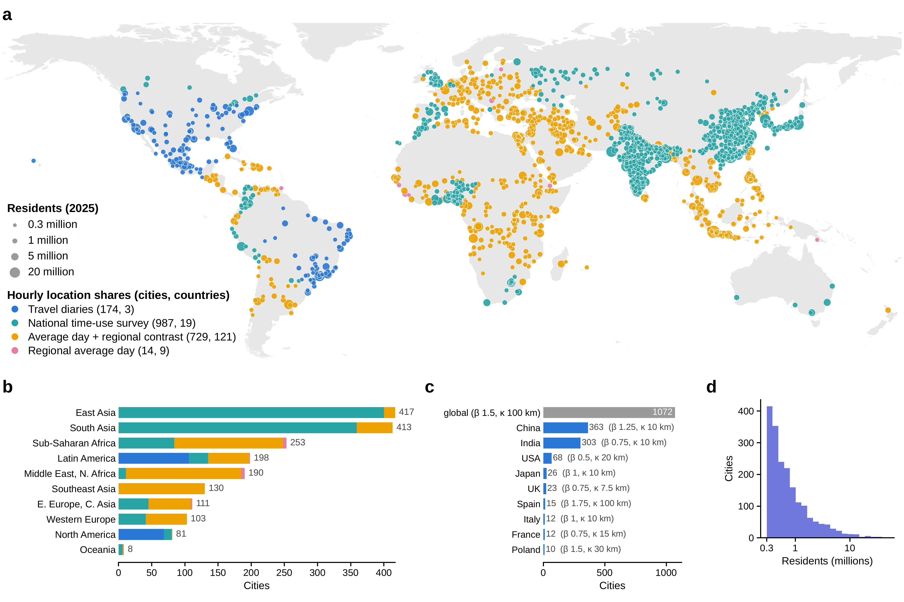
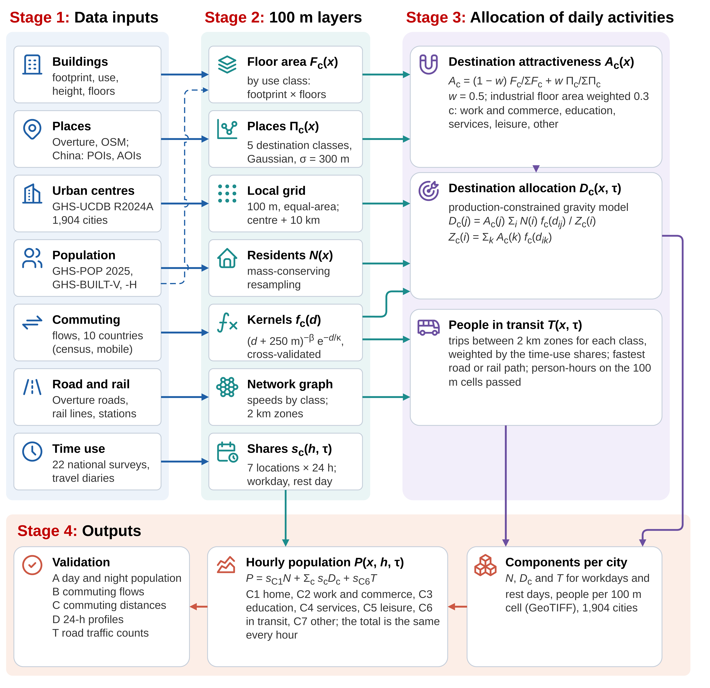
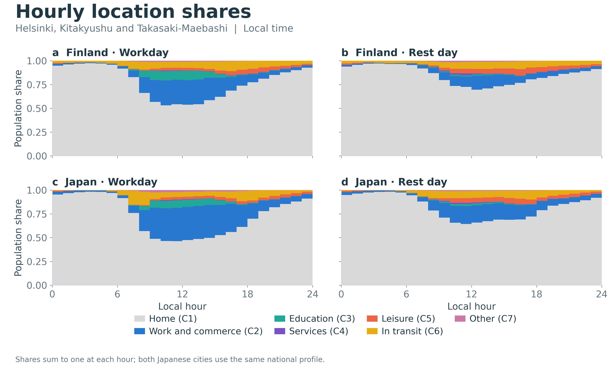
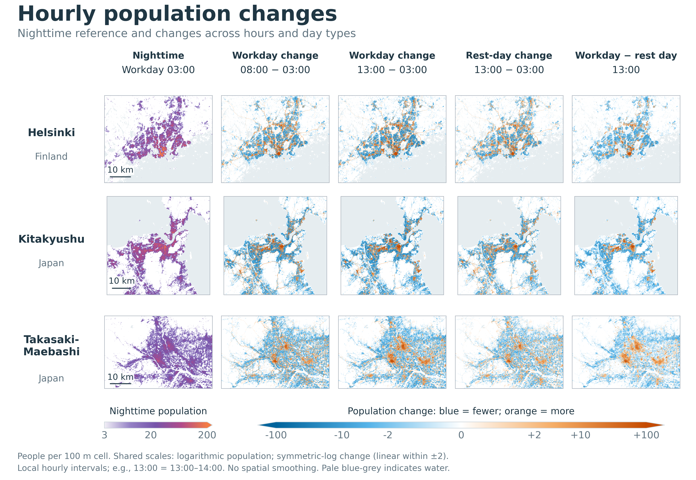

# GlobalDynPop

GlobalDynPop models hourly urban population distributions at 100 m resolution for typical workdays and rest days using a production-constrained gravity model. Its global application covers 1,904 urban centres across 152 countries, delineated by the Global Human Settlement Layer Urban Centre Database (GHS-UCDB R2024A) and selected for populations of at least 300,000 in 2025.

The model combines three types of evidence: spatial data define where people live, where activities take place and how locations are connected; time-use surveys and travel diaries describe how population shares across home, activity destinations and transit vary by hour; and census commuting records, mobile-phone-derived origin–destination flows and published commuting-distance statistics inform the gravity model's distance-decay parameters.

A production-constrained gravity model distributes residents among activity destinations according to destination attractiveness and travel distance, preserving the population assigned from each origin. Attractiveness reflects building floor area, points of interest and outdoor activity spaces, weighted by indoor-time shares and constrained by land and water coverage. Network routing estimates the distribution of people in transit. These destination and transit components are combined with resident population using hourly activity-location shares to produce 100 m population maps for workdays and rest days.

This repository provides the processing workflow, input subsets, intermediate layers and outputs for three worked examples: Helsinki, Kitakyushu and Takasaki-Maebashi.

## Study area and data coverage

Figure 1 shows the global distribution of the study cities, coloured by the source used to derive their hourly location shares: travel diaries, national time-use surveys, national average-day profiles with borrowed regional day-type contrasts, and regional average-day profiles. The accompanying charts show how these sources are distributed across regions, which cities use national or global distance-decay kernels, and the distribution of urban-centre population sizes.



**Figure 1. Global city coverage and input data.** Panel a shows study cities, coloured by the source of hourly location shares and sized by resident population in 2025; b summarises time-use source coverage by region; c shows the city counts assigned to national or global kernel groups; d shows the population-size distribution.

## Principal data sources

The research draws on global settlement and population databases, building data and points of interest (POIs), land-use data, transport networks, time-use surveys, travel diaries and commuting statistics. The main sources are summarised below.

| Data source | Provider | Version or reference period | Data content |
|---|---|---|---|
| GHSL Urban Centre Database (GHS-UCDB) | European Commission, Joint Research Centre | R2024A; 2025 city attributes | Urban-centre boundaries, city identifiers, resident populations and urban-centre areas. |
| [GHSL population (GHS-POP)](https://human-settlement.emergency.copernicus.eu/ghs_pop2023.php) | European Commission, Joint Research Centre | R2023A, 2025 epoch | Gridded resident population counts. |
| [GHSL built volume (GHS-BUILT-V)](https://human-settlement.emergency.copernicus.eu/ghs_buV2023.php) | European Commission, Joint Research Centre | R2023A, 2025 epoch | Gridded total and non-residential building volumes. |
| [GHSL building height (GHS-BUILT-H)](https://human-settlement.emergency.copernicus.eu/ghs_buH2023.php) | European Commission, Joint Research Centre | R2023A, 2018 epoch | Gridded mean building-height estimates, expressed in metres. |
| GlobalBuildingAtlas | Technical University of Munich and contributors | LoD1, 2025 release | Building footprints and heights; capacity and open-space calculation. CC BY-NC 4.0 applies to derived example layers. |
| ESA WorldCover and JRC Global Surface Water | ESA and JRC | WorldCover 2021; GSW v1.4 | Land-cover and permanent-water evidence combined with OSM water polygons. |
| Exposure-factor and time-use sources | National agencies and published studies | Source-specific years | City W_indoor assignments; source and reference-country tables are included. |
| HAPEM-MS3 | US Environmental Protection Agency | Adopted activity-data tables | Outdoor micro-environment weights, transferred to the activity classes. |
| Overture Maps Buildings | Overture Maps Foundation and contributing providers | Release 2026-10-21.0 | Building footprint polygons, building-use attributes, and available building heights in metres and floor counts. |
| [OpenBuildingMap](https://doi.org/10.5880/GFZ.LKUT.2025.002) | OpenBuildingMap; GFZ Data Services | 2025 dataset | Building occupancy classifications, height values in metres, and exact or ranged storey counts encoded in the building taxonomy. |
| Overture Maps POIs (Places) | Overture Maps Foundation and contributing providers | Release 2026-10-21.0 | POI locations, business and activity categories, and available operating-status attributes. |
| OpenStreetMap | OpenStreetMap contributors | Planet snapshot 2026-10-22 | Mapped points of interest and associated activity tags. |
| Overture Maps Transportation and Infrastructure | Overture Maps Foundation and contributing providers | Release 2026-10-21.0 | Road and rail segments, stations and other transport-infrastructure features. |
| Overture Maps Land Use | Overture Maps Foundation and contributing providers | Release 2026-10-21.0 | Land-use polygon geometries with class and subtype attributes describing mapped land functions. |
| Overture Maps Water | Overture Maps Foundation and contributing providers | Release 2026-10-21.0 | Water-body polygon geometries and associated attributes. |
| China POI dataset (CN_POI) | Commercial dataset using the Amap classification system | 2025 and 2026 editions | POI names, activity categories and coordinates for Chinese cities. |
| Amap Web Services | Amap | 2026 collection | POI records and AOI information. |
| National time-use surveys | National statistical agencies | Survey-specific years | Activity episodes, location records, survey weights, and published hourly or daily activity tables. |
| National Household Travel Survey (USA), EOD (Mexico), and São Paulo Origin-Destination Survey (Brazil) | FHWA; INEGI; São Paulo Metro | 2017 | Household travel diaries, trip times, purposes and associated survey information. |
| Census and mobility-based commuting datasets | National census agencies and mobility-data providers | Source-specific years | Commuting flows and travel-distance information. |

GHSL population grids provide the resident population at each origin. GlobalBuildingAtlas footprints and heights determine building floor area, while Overture Maps, OpenBuildingMap and land-use polygons supply building-use information. Overture Places and supplementary OpenStreetMap POIs identify activity destinations and contribute to their attractiveness; CN_POI and Amap records provide work and commercial POIs in mainland China.

Outdoor activity areas are derived from Overture land-use polygons and road geometry, excluding building footprints and permanent water. These layers distinguish streets, parks, plazas, campus grounds and other open spaces for allocating outdoor population. Overture road and rail networks support trip routing. ESA WorldCover, JRC Global Surface Water and OSM water polygons supplied through Overture jointly define permanent-water fractions. The [raw-data guide](01_inputs/demo/raw/README.md) documents the source subsets, file organisation and offline reconstruction for the three example cities.

Temporal inputs describe hourly activity-location shares and time spent indoors. The [time-use guide](04_intermediate/time_use.md) documents survey and diary sources, the 22 countries with country-specific workday/rest-day evidence, and profile construction and transfer. The [indoor-share guide](04_intermediate/w_indoor.md) explains how exposure-factor and time-use evidence informs W_indoor and its assignment to cities. Outdoor micro-environment weights are drawn from HAPEM-MS3.

Source datasets differ in reference year and coverage. See the [data attribution guide](06_docs/reproduction/city_demo.md#data-sources-and-attribution) for versions and terms of use, and the [methods](06_docs/README.md#methods) for processing steps, fallback rules and parameter derivation.

## Processing workflow

Figure 2 shows the four-stage calculation. Stage 1 defines city grids and source subsets. Source data are then converted to 100 m layers, then used to estimate destination attractiveness, gravity-based destination allocation and network transit. Hourly location shares combine the resulting components into population grids.



**Figure 2. Model calculations and data flow.** This diagram describes the modelling workflow; the validation panel refers to the study evaluation, external to the three-city numerical reproduction. Arrows connect raw inputs, prepared layers, activity-allocation components and outputs. Time-use shares feed both transit calculation and the final hourly mixture. Components and hourly grids preserve the city-domain population total.

| Stage | Purpose | Products | Method | Code |
|---|---|---|---|---|
| 1. City grids and data inputs | Select urban centres, define local 100 m grids and extract source data for their model domains, preserving source attributes, geometries and native raster pixels. Record provenance and verify file integrity. | City grid definitions, source subsets and source records. | [Method](06_docs/methods/stage_1_data_inputs.md) | [Code](02_code/stage_1_data_inputs/) |
| 2. 100 m layers | Read Stage 1 grids; derive resident population, building floor area and POI layers; build road/rail graphs; assemble hourly location shares and distance-decay settings. | Spatial model layers, routing graphs, hourly location shares and effective kernels. | [Method](06_docs/methods/stage_2_100m_layers.md) | [Code](02_code/stage_2_100m_layers/) |
| 3. Allocation of daily activities | Calculate destination attractiveness, distribute residents with the production-constrained gravity model, and assign trip person-time to the transport network. | Destination attractiveness, destination and in-transit population components by activity and day type, and packaged component GeoTIFFs. | [Method](06_docs/methods/stage_3_activity_allocation.md) | [Code](02_code/stage_3_activity_allocation/) |
| 4. Outputs | Combine population components using hourly location shares; derive functional land use; check and visualise the results. | Hourly population GeoTIFFs (24 single-band files per city and day type), functional land-use layers, figures and numerical checks. | [Method](06_docs/methods/stage_4_outputs.md) | [Code](02_code/stage_4_outputs/) |

Routing zones start at 2 km and expand for large domains. Survey harmonisation and parameter calibration precede population allocation. The 100 m output grid does not imply that routing or validation is performed at 100 m.

## Three-city example

### Run the example

```console
conda env create -f environment.yml
conda activate dynamic-population
python 03_run/run_city_demo.py run
python 03_run/run_city_demo.py check
```

`run` rebuilds city grids and spatial inputs from the bundled raw subsets, calculates destination attractiveness, assigns road/rail trips, computes population components, and generates hourly population, functional land use and figures. Results are written under `04_intermediate/demo/reproduction/`; every stage reads the preceding stage's results in that directory. `check` verifies the completed run, including all 144 hourly grids against mixtures of its own components. Use `run --stage 1`, `2`, `3`, `4` in order for separate stage execution, or `--out PATH` for an independent run. Missing prerequisites and calculation failures stop execution. Hourly shares and calibrated parameters are supplied non-spatial research inputs. See the [run guide](03_run/README.md) for execution and reference-comparison commands. Observation-based validation requires external records.

The [three-city guide](06_docs/reproduction/city_demo.md) records city selection, validation evidence and data attribution. The [run guide](03_run/README.md) covers launchers, path settings and the recorded test environment.

### Hourly activity patterns

Figure 3 shows the hourly location shares used for Finland and Japan. Home accounts for most of the population in the early morning, while work, education and other activities gain share during the day. The displayed profiles have higher daytime home shares on rest days than on workdays.



**Figure 3. Temporal weights applied to the population components.** Columns distinguish workdays and rest days; rows distinguish Finland and Japan. The seven coloured shares represent home, work and commerce, education, services, leisure, transit and other locations, and sum to one at every hour. Helsinki uses the Finland profile; both Japanese cities use the Japan profile. The [time-use guide](04_intermediate/time_use.md) documents the survey mapping, donor transfer and corrections used to construct these profiles.

### Example population distributions

Figure 4 separates the underlying population distribution from changes across hours and day types. A nighttime reference map is followed by signed differences, making population gains and losses directly visible.



**Figure 4. Hourly population changes.** Rows show Helsinki, Kitakyushu and Takasaki-Maebashi. From left to right: workday population at 03:00; workday 08:00 minus 03:00; workday 13:00 minus 03:00; rest-day 13:00 minus 03:00; and workday minus rest day at 13:00. Each time denotes the following one-hour interval in local time. Differences are people per 100 m cell: blue indicates fewer people and orange indicates more, relative to the stated reference. All difference maps share a symmetric-log scale from −100 to +100, linear between −2 and +2; larger magnitudes use the endpoint colours. Nighttime maps share a separate logarithmic scale from 3 to 200, with values below 3 hidden and values above 200 using the endpoint colour. The full model domains are displayed at native resolution without spatial smoothing. Pale blue-grey indicates water. Rest days represent typical rest-day conditions, not specific public holidays.

## Repository layout

```text
01_inputs/demo/raw/       Original-source subsets and provenance for the three cities
02_code/stage_*/          Numbered programs and calculation modules by stage
03_run/                  Three-city runner, stage launchers and execution support
04_intermediate/demo/    Stage 1 grids, Stage 2 layers/settings and Stage 3 allocation arrays
05_outputs/demo/         Population components, hourly grids and functional land use
06_docs/methods/         Processing methods and code links for each stage
06_docs/figures/         Workflow, population maps and time-use plots
06_docs/reproduction/    Three-city example and source attribution
```

The [intermediate-data dictionary](04_intermediate/README.md) and [output dictionary](05_outputs/README.md) describe file contents and units. [Raw data coverage](01_inputs/demo/raw/README.md) identifies the supplied sources. Other cities require compatible external inputs; see [run guide](03_run/README.md#other-city-inputs-and-result-comparison).

## Assumptions and parameter sources

The model conserves population within each city domain, including its surrounding margin. It cannot independently estimate net evacuation or migration across that boundary. Routing uses fixed class-specific speeds and a fixed spatial transit pattern within each day type. The model separates indoor and outdoor destination weights. W_indoor is a daily indoor-time proportion used as a proxy for the indoor fraction of away-from-home activities; it is not a direct measurement of that conditional fraction. Outdoor weights describe destination attractiveness before the gravity allocation, not a guaranteed final indoor population fraction. The [Stage 3 method](06_docs/methods/stage_3_activity_allocation.md) describes routing assumptions and implementation behaviour.

Parameter values and their evidence are documented in the [Stage 2](06_docs/methods/stage_2_100m_layers.md#parameter-values-and-sources), [Stage 3](06_docs/methods/stage_3_activity_allocation.md#parameter-values-and-sources) and [Stage 4](06_docs/methods/stage_4_outputs.md#parameter-values-and-sources) methods.

## Citation

Long, Z.-Y., Yang, R.-Y. & Duan, H.-F. Human mobility reshapes global urban flood risk patterns. Unpublished manuscript.

When reusing the data, also cite the relevant original datasets listed under [Data sources and attribution](06_docs/reproduction/city_demo.md#data-sources-and-attribution).

## Licence and data terms

GlobalDynPop software is licensed under the [GNU General Public License v2.0](LICENSE) (GPL-2.0). The GBA-derived example inputs and population products have non-commercial data terms described in [LICENSE_DATA.md](LICENSE_DATA.md). Source datasets and derived database layers retain their applicable data licences and attribution requirements, documented under [Data sources and attribution](06_docs/reproduction/city_demo.md#data-sources-and-attribution).
